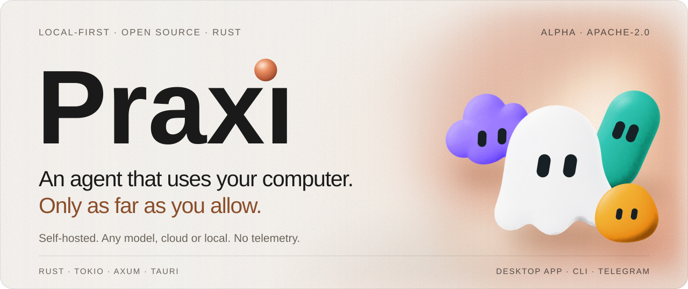
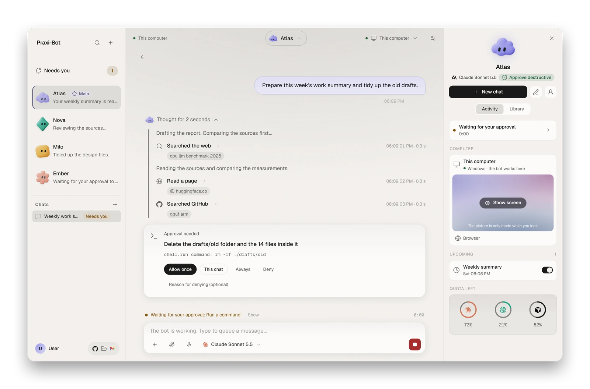
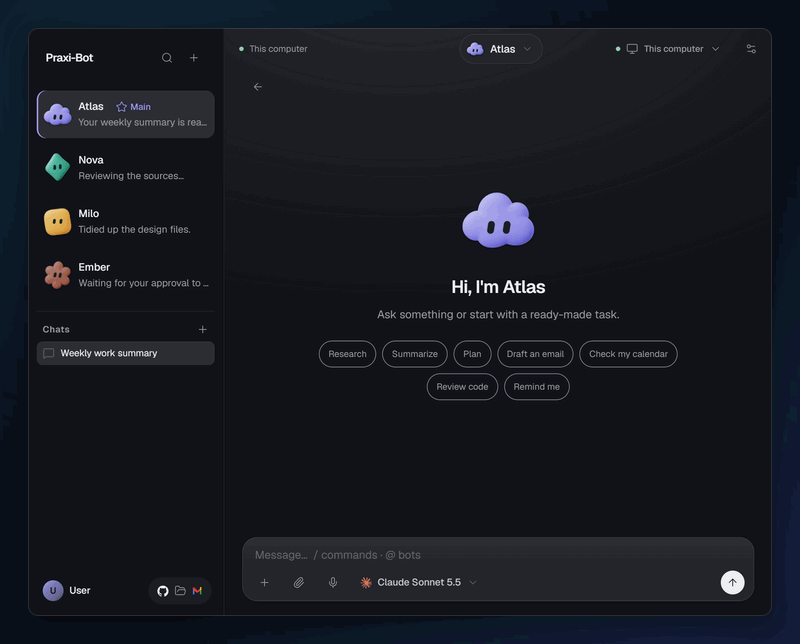
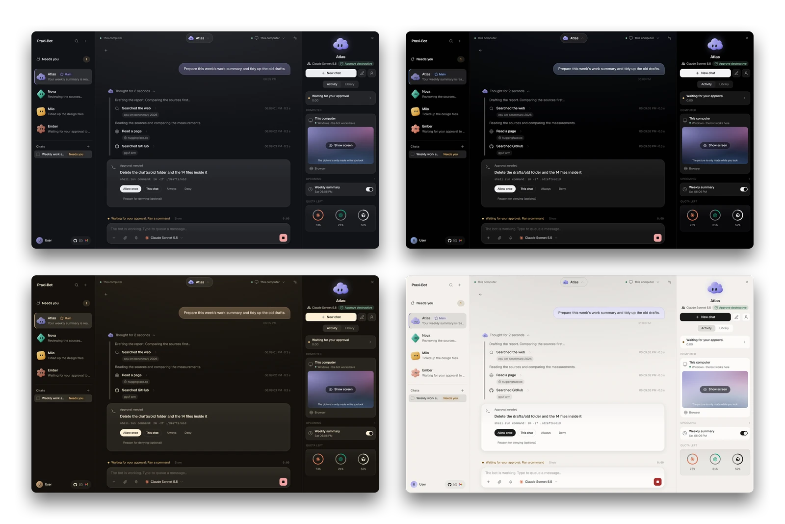
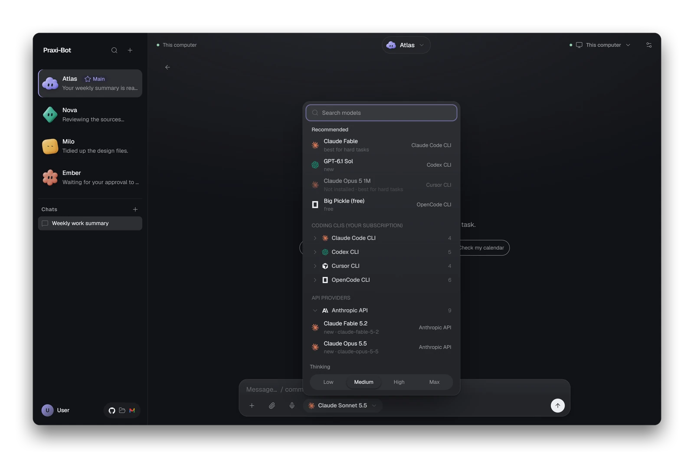
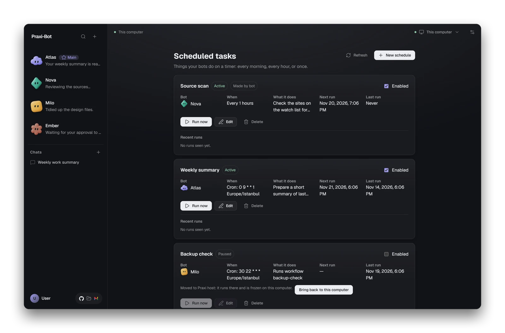
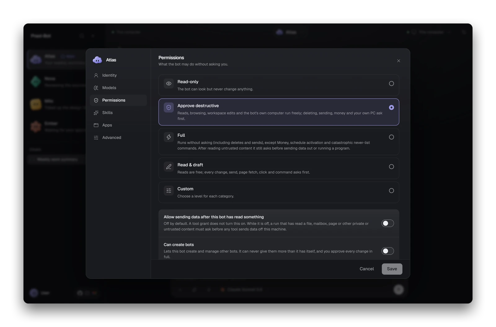
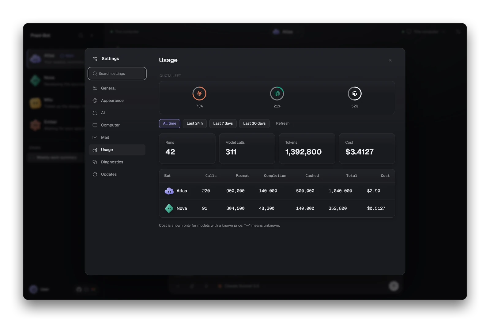
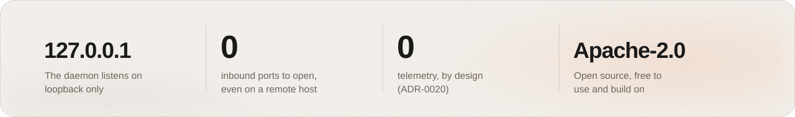
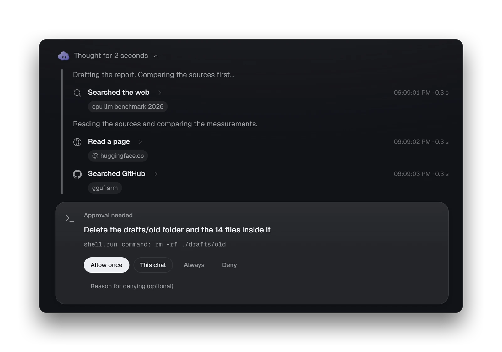

<div align="center">

<picture>
  <source media="(prefers-color-scheme: dark) and (max-width: 680px)" srcset="docs/assets/readme/hero-dark-mobile.svg">
  <source media="(prefers-color-scheme: light) and (max-width: 680px)" srcset="docs/assets/readme/hero-light-mobile.svg">
  <source media="(prefers-color-scheme: dark)" srcset="docs/assets/readme/hero-dark.svg">
  
</picture>

**A self-hosted, open-source AI agent that works on your computer: you pick the model, and every action that changes something asks you first.**

[](LICENSE)
[](https://github.com/emreocell/Praxi-Bot/releases)
[](https://github.com/emreocell/Praxi-Bot/actions/workflows/ci.yml)
[](https://github.com/emreocell/Praxi-Bot/actions/workflows/installer.yml)
[](https://github.com/emreocell/Praxi-Bot/labels/good%20first%20issue)
[](https://github.com/emreocell/Praxi-Bot/stargazers)

[Install](#install) · [How it works](#how-it-works) · [Screenshots](#screenshots) · [Security](#security-model) · [Docs](#documentation) · [Contribute](#contribute-in-10-minutes)

</div>

<picture>
  <source media="(prefers-color-scheme: dark)" srcset="docs/assets/readme/screens/product-dark.webp">
  
</picture>

<p align="center"><sub>Demo data shown: the screenshots on this page come from the desktop UI in mock mode, not from a real account.</sub></p>

<p align="center">
  
</p>

<p align="center"><sub>Ask, watch the steps, approve or deny. Demo data shown.</sub></p>

> **Project status: alpha.** The latest pre-release is `v0.1.0-alpha.2` (the first was `v0.1.0-alpha.1`). There is no stable API and things change quickly. Expect breaking changes, and back up your data directory before updating. Only the latest pre-release is supported (see [SECURITY.md](SECURITY.md)).

## What it does

Praxi runs a local daemon (Rust, tokio and axum) on your machine. You chat with *bots* from a desktop app (Windows), the `bot` command line or Telegram. A bot can read and edit files, run commands, drive a browser and operate desktop apps, always through a permission engine that checks every call in code.

<picture>
  <source media="(prefers-color-scheme: dark) and (max-width: 680px)" srcset="docs/assets/readme/features-dark-mobile.svg">
  <source media="(prefers-color-scheme: light) and (max-width: 680px)" srcset="docs/assets/readme/features-light-mobile.svg">
  <source media="(prefers-color-scheme: dark)" srcset="docs/assets/readme/features-dark.svg">
  
</picture>

## How it works

<picture>
  <source media="(prefers-color-scheme: dark) and (max-width: 680px)" srcset="docs/assets/readme/steps-dark-mobile.svg">
  <source media="(prefers-color-scheme: light) and (max-width: 680px)" srcset="docs/assets/readme/steps-light-mobile.svg">
  <source media="(prefers-color-scheme: dark)" srcset="docs/assets/readme/steps-dark.svg">
  
</picture>

1. **Install and pick a model.** Run the Windows installer and follow the setup wizard. Gemini has a free tier, and the key stays in your OS keychain.
2. **Create a bot.** Name it, pick its models and a permission preset. By default reads are free and every change asks first.
3. **Chat, approve, schedule.** Watch it work in the app or on Telegram, approve or deny each action, then put the job on a schedule.

<picture>
  <source media="(prefers-color-scheme: dark) and (max-width: 680px)" srcset="docs/assets/readme/architecture-dark-mobile.svg">
  <source media="(prefers-color-scheme: light) and (max-width: 680px)" srcset="docs/assets/readme/architecture-light-mobile.svg">
  <source media="(prefers-color-scheme: dark)" srcset="docs/assets/readme/architecture-dark.svg">
  
</picture>

The daemon (`bot serve`) listens on `127.0.0.1` only. Node-agents (experimental) and an optional always-on Linux host dial out to it, so no inbound port is ever opened. The crate map is in [CONTRIBUTING.md](CONTRIBUTING.md#the-architecture-on-one-screen).

## Screenshots

<p align="center">
  
</p>

<p align="center"><sub>Four themes (Obsidian, Cobalt, Raven, Clay). Demo data shown.</sub></p>

| | |
| --- | --- |
| <br>**Bots.** Give each one a clay character, a tint and a name. | <br>**Models.** Cloud APIs, local models or a coding CLI per bot. |
| <br>**Schedules.** Cron, every N hours, or plain English. | <br>**Live view.** Watch the screen, take control, stop. |
| <br>**Permissions.** Pick a preset per bot. | <br>**Usage.** Quota, runs, tokens and estimated cost. |

<details>
<summary>Switching themes (animation)</summary>


</details>

## Security model

An agent that can use your computer is powerful, and a web page or document can try to give it orders (prompt injection). Praxi puts hard limits in code, outside the model's reach. The full list, and what it does *not* protect you from, is in the [security model](docs/guide/security.md).

<picture>
  <source media="(prefers-color-scheme: dark) and (max-width: 680px)" srcset="docs/assets/readme/stats-dark-mobile.svg">
  <source media="(prefers-color-scheme: light) and (max-width: 680px)" srcset="docs/assets/readme/stats-light-mobile.svg">
  <source media="(prefers-color-scheme: dark)" srcset="docs/assets/readme/stats-dark.svg">
  
</picture>

<p align="center">
  
</p>

<p align="center"><sub>Every change asks first. Demo data shown.</sub></p>

- **Permissions are enforced by code, not by the model.** Every tool call goes through a resolver; the model cannot talk its way past it.
- **Defaults ask first.** Reads are free. Anything that changes files, clicks or types in apps, runs commands or sends messages needs your approval.
- **Floors no setting removes.** Money actions always ask, and a never-list of catastrophic shell commands always asks, even in the `full` preset.
- **Local-only daemon.** The API binds `127.0.0.1` and every call needs a bearer token.
- **Secrets stay out of files and logs.** API keys live in the OS keychain (Windows Credential Manager on Windows) or an encrypted file.
- **Stop at any time.** `Ctrl+Alt+Esc` (default), `/stop` in chat or Telegram, or take control in the app.
- **Audit trail, and no telemetry.** Approvals and denials go to an append-only log. Praxi does not phone home.

The shell is as dangerous as a terminal, the never-list is a safety net rather than a sandbox, and the Windows installer is not code-signed yet. Read the [limits](docs/guide/security.md#what-it-does-not-protect-you-from) before you trust it with anything important.

## Install

**Windows (installer).** Download the setup `.exe` from the [latest pre-release](https://github.com/emreocell/Praxi-Bot/releases). It is a per-user NSIS installer (no administrator rights) that installs the desktop app and the daemon under `%LOCALAPPDATA%\Programs\Praxi-Bot`. Until builds are signed, Windows SmartScreen may show *"Windows protected your PC"*: choose **More info**, then **Run anyway**. Details, upgrade and uninstall: [Installing on Windows](docs/guide/install-windows.md).

<details>
<summary>What happens on first launch</summary>

The app starts the bundled daemon and opens a five-step wizard (skip it at any step, re-run it from **Settings, First-run setup wizard**):

1. **Welcome:** language (English or Turkish) and theme (Light, Dark, System).
2. **Provider:** Google Gemini (free API tier, no credit card), Anthropic, an OpenAI-compatible service or local Ollama. The key goes straight to Windows Credential Manager and is never shown again. **Test connection** checks it.
3. **Safety:** default permission preset, **Approve destructive** unless you change it.
4. **First bot:** name, avatar and colour, and model roles pre-filled from your provider.
5. **Try it live:** send a sample request and approve or deny a real permission card.

Autostart at sign-in is off unless you enable it in Settings (or pass `/AUTOSTART=1` to the installer). Uninstalling keeps your chats, bots and settings unless you tick **Delete application data**. More in [Install and first run](docs/guide/install.md).

</details>

**Build from source** (Rust 1.89+, Node 24+, pnpm 10+, a C toolchain; MSVC build tools on Windows):

```sh
cargo build -p cli                                          # the daemon and CLI: target/debug/bot
./target/debug/bot setup && ./target/debug/bot serve        # pick a provider, then start the daemon
PRAXIBOT_FAKE_PROVIDER=1 pnpm dev:desktop                   # desktop app with a fake provider, no API key
```

To package the Windows installer yourself, see [Building the Windows installer yourself](docs/guide/install.md#building-the-windows-installer-yourself). An optional always-on Linux host is covered in [Running Praxi on a remote host](docs/guide/remote-host.md). The [CLI reference](docs/guide/cli-reference.md) lists every command.

## Providers and channels

- **Models:** Google Gemini (free tier), Anthropic, OpenRouter, DeepSeek, Ollama, LM Studio, and any OpenAI-compatible server. Locally installed coding CLIs can also act as engines; support differs per CLI ([details](docs/guide/cli-engines.md)). See [Providers and models](docs/guide/providers-and-models.md).
- **Channels:** the desktop app, the `bot` CLI and [Telegram](docs/guide/telegram.md) (`bot channels telegram setup` / `pair`; see also [docs/telegram.md](docs/telegram.md)). Telegram is the only messaging app so far.
- **Tools:** files, shell, browser, desktop, scripts, web, email, MCP servers, calendar, Home Assistant and Composio apps.

## Project status

- **Alpha.** No stable API; back up your data directory before updating.
- **Platforms.** The CLI and daemon build on Windows, Linux and macOS. Desktop control works on Windows and on Linux under X11 or Xvfb; the macOS backend is a stub and Wayland sessions are refused. The desktop app and installer are Windows only.
- **Experimental:** node-agents (`bot-node`) and controlling a paired PC.
- **Planned, not shipped:** recording a workflow by demonstration, a long-term memory the daemon enables, a plugin API, more messaging channels, and voice, image or video generation.

The [roadmap](docs/ROADMAP.md) has the horizons (no dates, no promises), and the [FAQ](docs/guide/faq.md) answers the common questions.

## Documentation

| Start here | Reference |
| --- | --- |
| [User guide](docs/guide/index.md) | [CLI reference](docs/guide/cli-reference.md) |
| [Install and first run](docs/guide/install.md) | [Troubleshooting](docs/guide/troubleshooting.md) |
| [Chatting and approvals](docs/guide/chatting-and-approvals.md) | [FAQ](docs/guide/faq.md) |
| [Bots and profiles](docs/guide/bots-and-profiles.md) | [Roadmap](docs/ROADMAP.md) |
| [Scheduled tasks](docs/guide/scheduled-tasks.md) | [Security model](docs/guide/security.md) and [SECURITY.md](SECURITY.md) |

## Contribute in 10 minutes

Praxi-Bot is built in the open and outside pull requests are welcome, from a typo fix to a feature.

1. **Pick something small.** Browse the [`good first issue`](https://github.com/emreocell/Praxi-Bot/issues?q=is%3Aissue+is%3Aopen+label%3A%22good+first+issue%22) issues or the [starter issues](docs/contributing/starter-issues.md). Issues #316 to #324 are fresh starters and are open right now.
2. **Claim it.** Comment "I would like to take this" before you start so nobody duplicates the work. A typo or docs fix needs no issue: edit the file in GitHub's web editor.
3. **Take a quick look without Rust.** Run `pnpm install --frozen-lockfile`, then `pnpm --dir apps/desktop/ui dev` and open `http://localhost:1420/?mock=1`. Mock mode serves canned data, so you see the whole UI with no daemon, no Tauri and no API key.
4. **Follow the 10-minute path** in [docs/contributing/FIRST_PR.md](docs/contributing/FIRST_PR.md), then read [CONTRIBUTING.md](CONTRIBUTING.md) for build, test and PR conventions. For the chat screen, approvals and permissions, and host flows, discuss in an issue first.

Please follow the [Code of Conduct](CODE_OF_CONDUCT.md), and report vulnerabilities privately as described in [SECURITY.md](SECURITY.md).

## License

Apache-2.0. See [LICENSE](LICENSE), [NOTICE](NOTICE) and [THIRD_PARTY_NOTICES.md](THIRD_PARTY_NOTICES.md).

<p align="center"><sub>README artwork is generated by <a href="scripts/readme-assets/README.md"><code>node scripts/readme-assets/build.mjs</code></a>. Screenshots use demo data.</sub></p>
