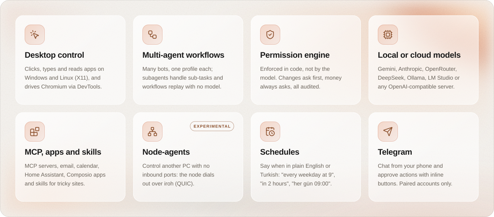
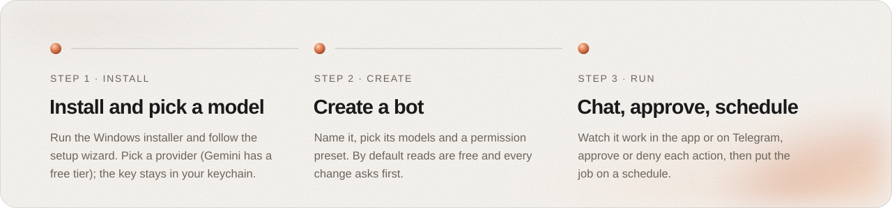
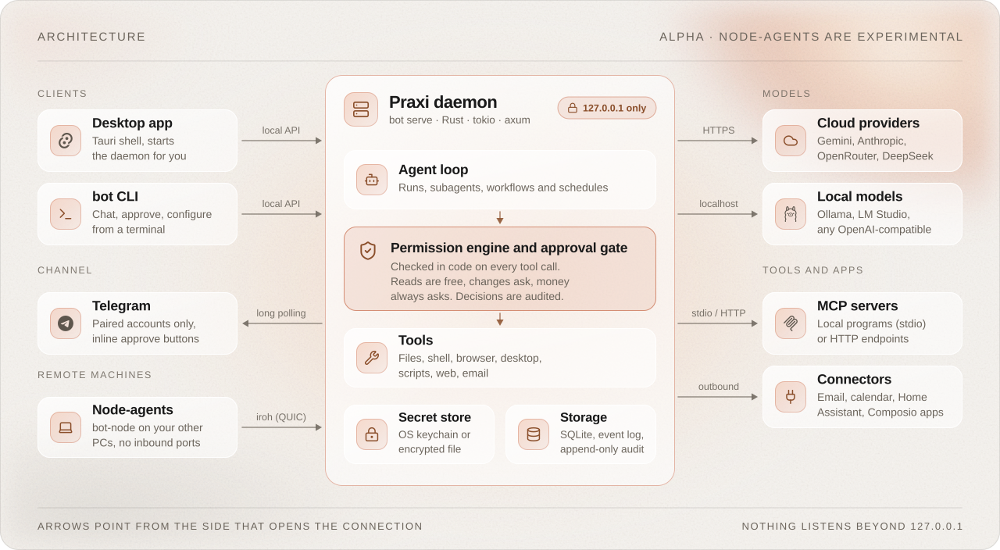
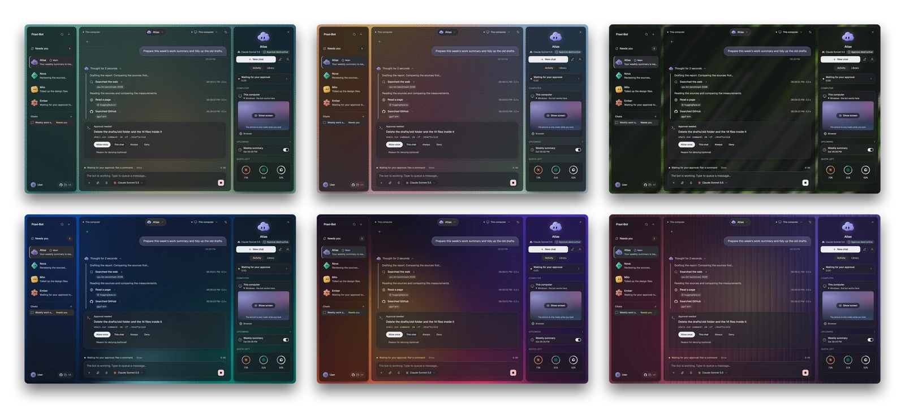
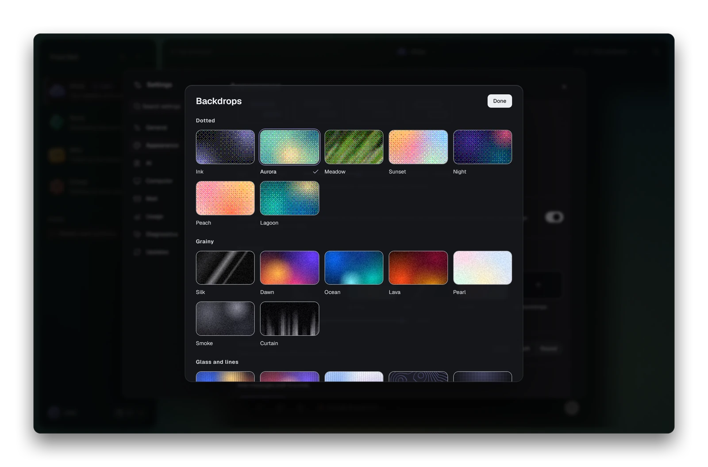
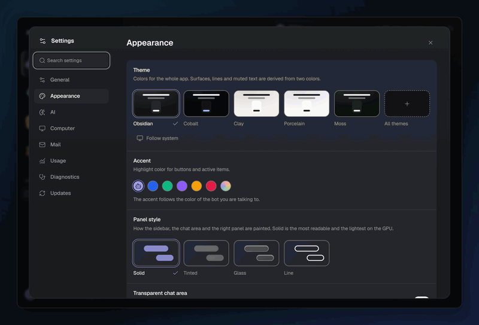
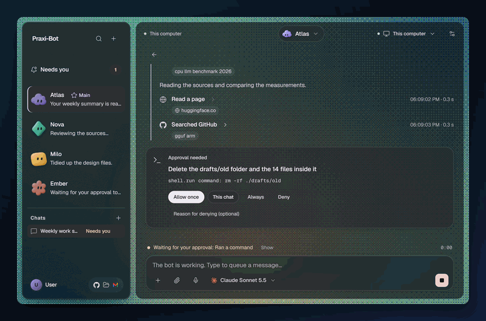
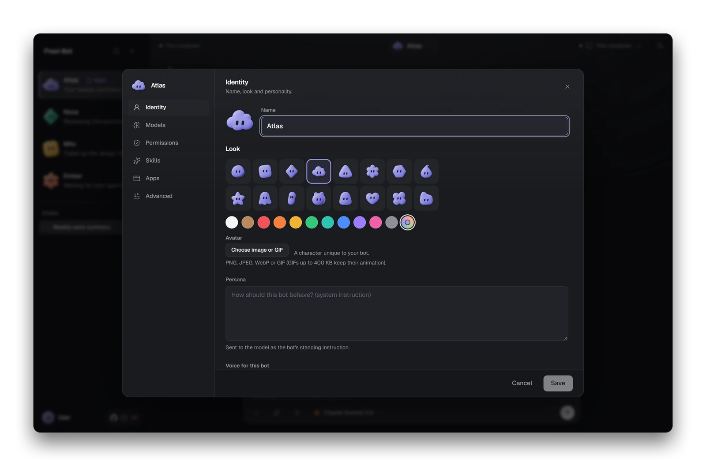
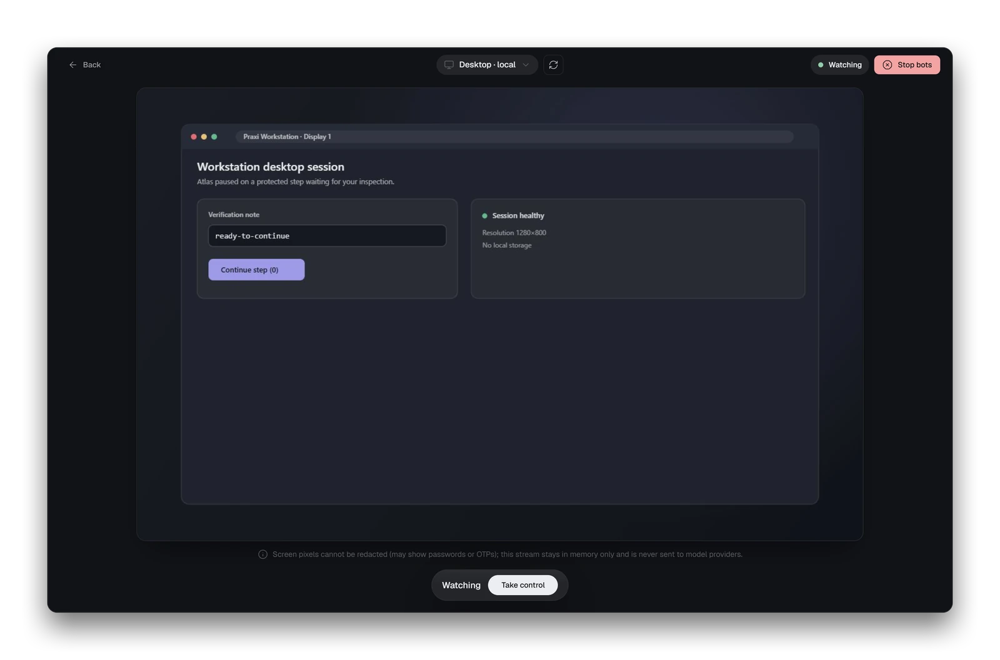

<div align="center">

<picture>
  <source media="(prefers-color-scheme: dark) and (max-width: 680px)" srcset="docs/assets/readme/hero-dark-mobile.svg">
  <source media="(prefers-color-scheme: light) and (max-width: 680px)" srcset="docs/assets/readme/hero-light-mobile.svg">
  <source media="(prefers-color-scheme: dark)" srcset="docs/assets/readme/hero-dark.svg">
  
</picture>

**A self-hosted, open-source AI agent that works on your computer: you pick the model, and every action that changes something asks you first.**

[](LICENSE)
[](https://github.com/emreocell/Praxi-Bot/releases)
[](https://github.com/emreocell/Praxi-Bot/actions/workflows/ci.yml)
[](https://github.com/emreocell/Praxi-Bot/actions/workflows/installer.yml)
[](https://github.com/emreocell/Praxi-Bot/labels/good%20first%20issue)
[](https://github.com/emreocell/Praxi-Bot/stargazers)

[Quickstart](#quickstart) · [Why it is different](#why-it-is-different) · [How it works](#how-it-works) · [Screenshots](#screenshots) · [Security](#security-model) · [Docs](#documentation) · [Contribute](#contribute-in-10-minutes)

</div>

<picture>
  <source media="(prefers-color-scheme: dark)" srcset="docs/assets/readme/screens/product-dark.webp">
  
</picture>

<p align="center"><sub>Demo data shown: the screenshots on this page come from the desktop UI in mock mode, not from a real account.</sub></p>

<p align="center">
  
</p>

<p align="center"><sub>Ask, watch the steps, approve or deny. Demo data shown.</sub></p>

> **Project status: alpha.** The latest pre-release is `v0.1.0-alpha.3`. There is no stable API and things change quickly. Expect breaking changes, and run `bot backup create <file>` (encrypted, see [docs/guide/backup.md](docs/guide/backup.md)) before updating. Only the latest pre-release is supported (see [SECURITY.md](SECURITY.md)).

## What it is

Praxi-Bot is an AI agent that runs on your own computer, not in someone else's cloud. You create *bots*, give each one a model and a permission level, and chat with them from a desktop app (Windows), the `bot` command line or Telegram. A bot can read and edit files, run commands, drive a browser and operate desktop apps. A local daemon (Rust) checks every one of those actions against your permissions before it happens.

## Why it is different

- **Local-first.** The daemon listens on `127.0.0.1` only and opens no inbound port. There is no Praxi account and no telemetry by design. Your chats, bots and settings stay in a folder on your machine, and API keys go to the OS keychain (or an encrypted file).
- **A permission model the AI cannot talk its way past.** Permissions are decided by code, not by the model. Reads are free, and by default anything that changes something asks you first. Money actions and a list of catastrophic shell commands always ask, even in the most permissive preset.
- **Untrusted content stays data.** Web pages, emails and tool output from MCP servers are treated as data, never as instructions. After a run has read untrusted or private content, anything that could send data off your machine asks first (the egress gate), even with a standing approval. A hermetic prompt-injection evaluation pack runs in CI ([`evals/`](evals/README.md)).
- **You pick the engine.** Cloud APIs, local models or a coding CLI you already have installed, per bot.

## What works today

Everything below is merged on `main`; the latest pre-release may lag behind it.

- **Chat and approvals** in the desktop app, the CLI and Telegram, with Allow once / This chat / Always / Deny cards and a stop key ([guide](docs/guide/chatting-and-approvals.md)).
- **Tools:** files, shell, browser (Chromium over DevTools), desktop control (Windows; Linux under X11), web research, email, calendar, Home Assistant, Composio apps and MCP servers. Approved MCP tool descriptions are pinned and a changed description is held back ([guide](docs/guide/mcp-servers.md)).
- **Bots and profiles** with per-bot models, permission presets and spending limits ([guide](docs/guide/bots-and-profiles.md)).
- **Schedules** in cron, interval or plain English / Turkish ([guide](docs/guide/scheduled-tasks.md)) and multi-step **workflows** ([guide](docs/guide/workflows.md)).
- **Skills and apps** you can add or write yourself ([skills](docs/guide/skills.md), [apps](docs/guide/apps.md)).
- **Voice:** hands-free call mode in the desktop chat ([guide](docs/guide/voice-call.md)).
- **An always-on Linux host** with a virtual display, so bots keep working when your computer is off ([guide](docs/guide/linux-host.md)).
- **Encrypted backup and restore** ([guide](docs/guide/backup.md)).
- **Desktop app in English, Turkish and German**, with themes and backdrops.
- **Experimental:** node-agents (`bot-node`) and controlling a paired PC.

<picture>
  <source media="(prefers-color-scheme: dark) and (max-width: 680px)" srcset="docs/assets/readme/features-dark-mobile.svg">
  <source media="(prefers-color-scheme: light) and (max-width: 680px)" srcset="docs/assets/readme/features-light-mobile.svg">
  <source media="(prefers-color-scheme: dark)" srcset="docs/assets/readme/features-dark.svg">
  
</picture>

## How it works

<picture>
  <source media="(prefers-color-scheme: dark) and (max-width: 680px)" srcset="docs/assets/readme/steps-dark-mobile.svg">
  <source media="(prefers-color-scheme: light) and (max-width: 680px)" srcset="docs/assets/readme/steps-light-mobile.svg">
  <source media="(prefers-color-scheme: dark)" srcset="docs/assets/readme/steps-dark.svg">
  
</picture>

1. **Install and pick a model.** Run the Windows installer and follow the setup wizard (English, Turkish or German). Gemini has a free tier, and the key stays in your OS keychain.
2. **Create a bot.** Name it, pick its models and a permission preset. By default reads are free and every change asks first.
3. **Chat, approve, schedule.** Watch it work in the app or on Telegram, approve or deny each action, then put the job on a schedule.

<picture>
  <source media="(prefers-color-scheme: dark) and (max-width: 680px)" srcset="docs/assets/readme/architecture-dark-mobile.svg">
  <source media="(prefers-color-scheme: light) and (max-width: 680px)" srcset="docs/assets/readme/architecture-light-mobile.svg">
  <source media="(prefers-color-scheme: dark)" srcset="docs/assets/readme/architecture-dark.svg">
  
</picture>

The daemon (`bot serve`) listens on `127.0.0.1` only. Node-agents (experimental) and an optional always-on Linux host dial out to it, so no inbound port is ever opened. The crate map is in [CONTRIBUTING.md](CONTRIBUTING.md#the-architecture-on-one-screen).

## Screenshots

### Make it yours: themes and backdrops

Four featured themes (Obsidian, Cobalt, Raven, Clay) with more to choose from, and 19 built-in backdrops in three families (Dotted, Grainy, and Glass and lines), plus your own image, with a calm/lively slider. Pick them in **Settings, Appearance**.

<p align="center">
  
</p>

<p align="center"><sub>Themes: Obsidian, Cobalt, Raven, Clay. Demo data shown.</sub></p>

<p align="center">
  
</p>

<p align="center"><sub>Backdrops: Aurora, Sunset, Meadow / Ocean, Dawn, Reeded rose. Demo data shown.</sub></p>

<p align="center">
  
</p>

<p align="center"><sub>The Backdrops picker, grouped by family. Demo data shown.</sub></p>

<details>
<summary>Animations: switching themes and backdrops</summary>





</details>

### More screens

| | |
| --- | --- |
| <br>**Bots.** Give each one a clay character, a tint and a name. | <br>**Models.** Cloud APIs, local models or a coding CLI per bot. |
| <br>**Schedules.** Cron, every N hours, or plain English. | <br>**Live view.** Watch the screen, take control, stop. |
| <br>**Permissions.** Pick a preset per bot. | <br>**Usage.** Quota, runs, tokens and estimated cost. |

## Security model

An agent that can use your computer is powerful, and a web page or document can try to give it orders (prompt injection). Praxi puts hard limits in code, outside the model's reach. The full list, and what it does *not* protect you from, is in the [security model](docs/guide/security.md).

<picture>
  <source media="(prefers-color-scheme: dark) and (max-width: 680px)" srcset="docs/assets/readme/stats-dark-mobile.svg">
  <source media="(prefers-color-scheme: light) and (max-width: 680px)" srcset="docs/assets/readme/stats-light-mobile.svg">
  <source media="(prefers-color-scheme: dark)" srcset="docs/assets/readme/stats-dark.svg">
  
</picture>

<p align="center">
  
</p>

<p align="center"><sub>Every change asks first. Demo data shown.</sub></p>

- **Permissions are enforced by code, not by the model.** Every tool call goes through a resolver; the model cannot talk its way past it.
- **Defaults ask first.** Reads are free. Anything that changes files, clicks or types in apps, runs commands or sends messages needs your approval.
- **Floors no setting removes.** Money actions always ask, and a never-list of catastrophic shell commands always asks, even in the `full` preset.
- **Local-only daemon.** The API binds `127.0.0.1` and every call needs a bearer token.
- **Secrets stay out of files and logs.** API keys live in the OS keychain (Windows Credential Manager on Windows) or an encrypted file.
- **Stop at any time.** `Ctrl+Alt+Esc` (default), `/stop` in chat or Telegram, or take control in the app.
- **Audit trail, and no telemetry.** Approvals and denials go to an append-only log. Praxi does not phone home.

The shell is as dangerous as a terminal, the never-list is a safety net rather than a sandbox, and the Windows installer is not code-signed yet. Read the [limits](docs/guide/security.md#what-it-does-not-protect-you-from) before you trust it with anything important.

## Quickstart

Pick your platform. Both take three steps.

### Windows (desktop app)

1. **Install.** Download the setup `.exe` from the [latest pre-release](https://github.com/emreocell/Praxi-Bot/releases). It is a per-user installer (no administrator rights). Until builds are signed, Windows SmartScreen may show *"Windows protected your PC"*: choose **More info**, then **Run anyway**.
2. **Set up.** The first launch opens a short wizard: language, provider (Gemini has a free API tier, no credit card), a safe permission preset and your first bot. Your key goes straight to Windows Credential Manager.
3. **Chat.** Send a request, watch the steps, and approve or deny each change. Details, upgrade and uninstall: [Installing on Windows](docs/guide/install-windows.md) and [Install and first run](docs/guide/install.md).

### Linux (always-on host)

Run these on the server over SSH, after downloading and verifying `install-linux.sh` as described in [Running Praxi on a remote host](docs/guide/remote-host.md). Replace `v0.1.0` with the release you want.

1. **Preview.** `bash ./install-linux.sh --dry-run --headless --version v0.1.0` changes nothing and needs no `sudo`.
2. **Install.** `sudo bash ./install-linux.sh --headless --version v0.1.0` installs the host (`127.0.0.1` only, no open port) with a virtual display and a browser.
3. **Check.** `sudo praxi doctor` tests the setup and prints the exact fix for each problem. More in [Linux always-on host](docs/guide/linux-host.md).

The desktop app and its installer are Windows only today. On Linux, the daemon and CLI run as the host.

### Build from source

Needs Rust 1.89+, Node 24+, pnpm 10+ and a C toolchain (MSVC build tools on Windows):

```sh
cargo build -p cli                                          # the daemon and CLI: target/debug/bot
./target/debug/bot setup && ./target/debug/bot serve        # pick a provider, then start the daemon
PRAXIBOT_FAKE_PROVIDER=1 pnpm dev:desktop                   # desktop app with a fake provider, no API key
```

The [CLI reference](docs/guide/cli-reference.md) lists every command. To package the Windows installer yourself, see [Building the Windows installer yourself](docs/guide/install.md#building-the-windows-installer-yourself).

## Supported engines, providers and channels

| Kind | What | Notes |
| --- | --- | --- |
| Cloud model APIs | Google Gemini, Anthropic, OpenRouter, DeepSeek, any OpenAI-compatible server | Gemini has a free tier. See [Providers and models](docs/guide/providers-and-models.md). |
| Local models | Ollama, LM Studio | Runs on your hardware. |
| Coding CLIs | Claude Code, Codex, Gemini CLI, Antigravity, Qwen Code, GitHub Copilot CLI, Kiro CLI, Kimi Code CLI, Qoder CLI, Mistral Vibe, OpenCode, Cursor | Detected if installed. Support differs per CLI: some run as the bot's brain, others are detection only ([details](docs/guide/cli-engines.md)). |
| Channels | Desktop app, `bot` CLI, [Telegram](docs/guide/telegram.md) | Telegram is the only messaging app so far. |
| Tools | Files, shell, browser, desktop, scripts, web, email, MCP servers, calendar, Home Assistant, Composio apps | Every call goes through the permission engine. |

## Status and roadmap

- **Alpha.** No stable API; back up before updating (`bot backup create <file>`).
- **Platforms.** The CLI and daemon build on Windows, Linux and macOS. Desktop control works on Windows and on Linux under X11 or Xvfb; the macOS backend is a stub and Wayland sessions are refused. The desktop app and installer are Windows only.
- **Not signed yet.** The Windows installer is not code-signed ([#203](https://github.com/emreocell/Praxi-Bot/issues/203)).
- **Planned, not shipped:** recording a workflow by demonstration, a plugin API ([#213](https://github.com/emreocell/Praxi-Bot/issues/213)), more messaging channels, a mobile companion ([#208](https://github.com/emreocell/Praxi-Bot/issues/208)), Linux and macOS desktop bundles ([#175](https://github.com/emreocell/Praxi-Bot/issues/175)).

The [roadmap](docs/ROADMAP.md) has the horizons (no dates, no promises). Open work is tracked in [issues](https://github.com/emreocell/Praxi-Bot/issues): look for the labels [`help wanted`](https://github.com/emreocell/Praxi-Bot/labels/help%20wanted) and [`good first issue`](https://github.com/emreocell/Praxi-Bot/labels/good%20first%20issue). The [FAQ](docs/guide/faq.md) answers common questions.

## Documentation

| Start here | Reference |
| --- | --- |
| [User guide](docs/guide/index.md) | [CLI reference](docs/guide/cli-reference.md) |
| [Install and first run](docs/guide/install.md) | [Host operations](docs/guide/host-operations.md) and [remote host](docs/guide/remote-host.md) |
| [Chatting and approvals](docs/guide/chatting-and-approvals.md) | [Troubleshooting](docs/guide/troubleshooting.md) and [FAQ](docs/guide/faq.md) |
| [Bots and profiles](docs/guide/bots-and-profiles.md) | [Roadmap](docs/ROADMAP.md) |
| [Scheduled tasks](docs/guide/scheduled-tasks.md) | [Security model](docs/guide/security.md) and [SECURITY.md](SECURITY.md) |

## Contribute in 10 minutes

Outside pull requests are welcome, from a typo fix to a feature.

1. **Pick something small:** an issue labelled [`good first issue`](https://github.com/emreocell/Praxi-Bot/issues?q=is%3Aissue+is%3Aopen+label%3A%22good+first+issue%22), or see the [starter issues](docs/contributing/starter-issues.md). Comment that you are taking it. Typo and docs fixes need no issue.
2. **See the UI without Rust:** `pnpm install --frozen-lockfile`, then `pnpm --dir apps/desktop/ui dev` and open `http://localhost:1420/?mock=1` (canned data, no daemon or API key).
3. **Follow** [docs/contributing/FIRST_PR.md](docs/contributing/FIRST_PR.md) from clone to pull request.
4. **Read** [CONTRIBUTING.md](CONTRIBUTING.md) for the build, CI gates and review expectations. For approvals and permissions, the chat screen and host flows, discuss in an issue first.
5. **Be kind and be careful:** follow the [Code of Conduct](CODE_OF_CONDUCT.md) and report vulnerabilities privately ([SECURITY.md](SECURITY.md)).

### Contributors

<!-- contributors:start -->
<a href="https://github.com/emreocell"></a>
<a href="https://github.com/husodrn46"></a>
<a href="https://github.com/RiccardoBifulco"></a>
<a href="https://github.com/MacallanTheRoot"></a>
<a href="https://github.com/MOzcelik14"></a>
<a href="https://github.com/yigitbuyukeren"></a>
<a href="https://github.com/almilasutorun"></a>
<a href="https://github.com/furkngrsy"></a>
<a href="https://github.com/harshit3355"></a>
<a href="https://github.com/Hikmet-Ocel"></a>
<a href="https://github.com/ozdil"></a>
<a href="https://github.com/pkryusuf"></a>
<a href="https://github.com/PrathamShenoy14"></a>
<a href="https://github.com/SyedTashfin"></a>
<a href="https://github.com/TunahanRT"></a>
<a href="https://github.com/abdullahkalim21"></a>
<a href="https://github.com/Golden007-prog"></a>
<a href="https://github.com/sparklyi"></a>
<a href="https://github.com/TuanNancy"></a>
<a href="https://github.com/enesgadis"></a>
<a href="https://github.com/SudeepGowda55"></a>
<a href="https://github.com/abubakarzohaib141"></a>
<a href="https://github.com/oguzhanakk"></a>
<a href="https://github.com/visy-ani"></a>
<a href="https://github.com/voidstackloop"></a>
<!-- contributors:end -->

<sub>People who authored commits, most active first. Generated by <a href="scripts/update_contributors.py"><code>python3 scripts/update_contributors.py</code></a>; AI tools that appear as co-authors are not listed. <a href="https://github.com/emreocell/Praxi-Bot/graphs/contributors">Contributors graph</a>.</sub>

More small tasks, written up so they can be opened as issues, are in [docs/GOOD_FIRST_ISSUES.md](docs/GOOD_FIRST_ISSUES.md). Wait until one is an issue, then comment there before you start.

## License

Apache-2.0. See [LICENSE](LICENSE), [NOTICE](NOTICE) and, for bundled third-party code, [THIRD_PARTY_NOTICES.md](THIRD_PARTY_NOTICES.md).

<p align="center"><sub>README artwork is generated by <a href="scripts/readme-assets/README.md"><code>node scripts/readme-assets/build.mjs</code></a>. Screenshots use demo data.</sub></p>
