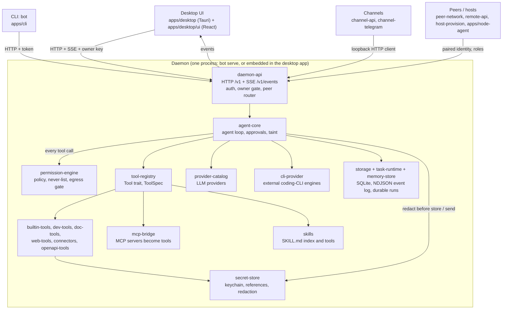

# Architecture tour

A map for new contributors. It tells you which crate does what, how one chat message travels
through the system, where the security boundaries are, where tests live, and how to add the five
most common things (a tool, a route, an eval scenario, a UI string, a channel).

Every name in this page was checked against the code when it was written. If you rename something
it mentions, update this page in the same PR. The docs link check
(`python scripts/check_markdown_links.py`) covers the links.

Contents: [Big picture](#big-picture) · [Crates](#crates) · [One message through the system](#one-message-through-the-system)
· [Security boundaries](#security-boundaries) · [Where tests live](#where-tests-live) · [How to add…](#how-to-add)

## Big picture

Read the diagram top to bottom: clients never talk to the loop directly, they go through
`daemon-api`. The loop never runs a tool without asking `permission-engine`. Secrets are referenced
by name and removed from text by `secret-store` before text is stored, sent to a model or shown.

**Host / peer model.** One machine runs the daemon and is the *host*. Other machines (a second
desktop, a phone, a node agent, a rented server) are *peers*: they pair once with an invite
(`peer-network`, identified by public key) and afterwards reach the host's API through
`remote-api`. A peer's role (`Desktop`, `Phone`, `Node`, `Host`, see `PeerRole` in
`crates/daemon-api/src/peer.rs`) comes from the pairing store, never from an HTTP header.
`apps/node-agent` (`bot-node`) runs on a machine the bot is allowed to control;
`host-provision` turns a rented Linux server into a paired host over SSH. User-facing description:
[docs/guide/remote-host.md](../guide/remote-host.md).

## Crates

Paths are `crates/<name>` unless marked `apps/`. Each entry says what the crate is for, what it
leans on or serves, and what it deliberately does not do.

### Core: the daemon and the loop

- **`daemon-api`**: the one local HTTP API (`/v1`, axum) plus one SSE stream (`GET /v1/events`).
  Owns auth, the owner gate (`owner.rs`), the peer router (`peer.rs`), the route table
  (`api_routes` in `lib.rs`) and the generated OpenAPI snapshot (`docs/api/openapi.json`).
  Library first: the desktop app embeds it and `bot serve` just runs it. It contains no model logic.
- **`agent-core`**: `AgentLoop::run_turn` and friends: model → tool calls → permission check →
  execute → results back → repeat, on top of `task-runtime`. Also approvals (`approval.rs`),
  content-exposure tracking (`taint.rs`), compaction, sub-agents, spend limits.
  It decides *when* to ask; it does not define the policy rules themselves.
- **`permission-engine`**: resolves one tool call to `Decision::Allow`, `Ask` or `Deny` from the
  policy, the never-list (`never_list.rs`) and the egress gate (`egress.rs`).
  Pure logic with no I/O, so it is cheap to test. The audit trail lives in `storage`.
- **`tool-registry`**: the `Tool` trait, `ToolSpec` (name, schema, `Effect`, `PermissionCategory`,
  `ContentClass`) and the `ToolRegistry` that lists and finds tools. It refuses a tool whose
  `ContentClass` was not declared. It runs nothing by itself.
- **`protocol`**: serde/JSON-schema types shared by daemon, clients and node agents: events
  (`ApprovalNeeded`, …), ids, permission categories, approval text. Keep it free of behaviour.
- **`task-runtime`**: durable runs. Every step is persisted before (intent) and after (result), so a
  crash leaves an auditable trail and `Runtime::recover` can resume. Not the scheduler (see below).
- **`storage`**: SQLite (WAL, forward-only migrations) and per-run NDJSON event logs for messages,
  audit and stream replay. Synchronous; callers use `spawn_blocking` where it matters.
- **`memory-store`**: `memory.db`: persistent memory, hybrid retrieval, extraction pipeline and
  the bot knowledge sources. Kept separate from `storage`'s database.
- **`agent-router`**: the layered decision cascade (rules, intent cache, local embedding + BM25,
  fast classifier, full LLM planning) that picks tools, skills or workflows for an intent.
- **`scheduler`**: durable scheduled tasks (cron, interval, one-shot), misfire policies, HMAC webhook
  triggers, and the EN/TR natural-language schedule parser.
- **`workflow-replay`**: records a successful run as a parameterised workflow and replays it with
  zero model calls, still through the permission gate.
- **`evals`**: the evaluation harness: hermetic tier-1 YAML scenarios, opt-in live tier-2 tasks,
  metrics and reports (`bot-eval` binary). See [eval scenarios](eval-scenarios.md).

### Models and engines

- **`provider-catalog`**: LLM provider trait and built-in adapters (Anthropic, OpenRouter,
  DeepSeek, Ollama, any OpenAI-compatible endpoint, Gemini), model metadata, local-model advice.
  A uniform streaming interface; no tool or permission logic.
- **`cli-provider`**: detects installed, signed-in coding CLIs (`claude`, `codex`, `cursor`,
  `opencode`, `gemini`, …) and runs them as an *engine* for a bot. Adding one:
  [adding a CLI engine](adding-cli-engine.md).
- **`process-guard`**: defence in depth for the daemon against its own same-user children
  (shell tools, MCP servers, CLIs): blocks same-user memory reads. Not a sandbox.

### Tools

- **`builtin-tools`**: the built-in set (desktop, browser, files with checkpoints, shell, script,
  notes, schedule, meta). `register_builtin_tools` puts them in a registry.
  The default home for a new general-purpose tool.
- **`dev-tools`**: `git_*` tools (via the `git` CLI, never a shell) and a read-only `process_list`.
  A good small example to copy: `crates/dev-tools/src/process.rs`.
- **`doc-tools`**: PDF, DOCX, XLSX, PPTX, CSV and JSON tools. All use the `Fs` permission category.
- **`web-tools`**: readable HTML → Markdown, web search backends, RSS/Atom, sitemaps, page metadata,
  all behind an SSRF-safe `UrlPolicy`. Results are untrusted content.
- **`connector-email`**, **`connector-calendar`**, **`connector-homeassistant`**: IMAP/SMTP, CalDAV
  and Home Assistant as permission-gated tools. Credentials are secret *references*; text read from
  third parties is marked untrusted.
- **`composio`**, **`openapi-tools`**: third-party app actions through the owner's Composio key, and
  OpenAPI 3.x specs imported as dynamic tools.
- **`script-runtime`**: the embedded JavaScript sandbox for "code as action": one program that calls
  several tools and returns a compact result. Its calls still pass the permission gate.
- **`mcp-bridge`**: MCP client (stdio or streamable HTTP). Every tool of a configured server is
  registered as `mcp:<server>/<tool>`; their output is untrusted by default (`class_of` in
  `tool.rs`). Also server config storage, OAuth and diagnostics.
- **`skills`**: the Markdown skill system: a directory with `SKILL.md`, layered sources, a short
  prompt index and skill tools. A skill saved after untrusted content was read is stored as data.
- **`plugin-host`**: reserved placeholder with no code yet (tracked in issue #213).

### Secrets and safety plumbing

- **`secret-store`**: `SecretStore` (OS keychain or encrypted-file backend), `SecretRef`/`SecretValue`,
  and the `Redactor` that removes known secrets and secret-shaped patterns from text.
  Nothing else should hold or print a raw key.
- **`computer-target`**: per-bot choice of *which computer* UI automation runs on (this PC, the
  host, a paired server) and its resolution at the start of a run.

### Desktop control

- **`desktop-api`**: OS-agnostic `DesktopBackend` trait and shared types (accessibility snapshot,
  input, screenshot) plus the guard wrapper. Backends implement it; the loop never sees the OS.
- **`desktop-windows`**, **`desktop-linux`**, **`desktop-macos`**: the OS backends
  (UI Automation + `SendInput`; AT-SPI2 + XTest; Accessibility API + `CGEvent`).
- **`browser-cdp`**: Chrome DevTools Protocol automation: ref-indexed snapshots, DOM diff,
  live-view screencast with viewport-mapped human input.
- **`vision`**: OCR, set-of-marks annotation and grid localisation when there is no accessibility tree.
- **`live-view`**: memory-only screen transport contracts. It must never log input or pixels.
- **`windows-sandbox-spike`**: a standalone experiment; no daemon tool calls it.

### Hosts, peers and remote

- **`peer-network`**: iroh transport: public-key identities, invite-based pairing, JSON-RPC
  desktop control, events, and a remote `DesktopBackend`.
- **`remote-api`**: HTTP/1.1 streamed over the paired-only `bot/api/1` ALPN, plus an authenticated
  loopback proxy, so a paired peer can use the host's API.
- **`host-provision`**: provisions a rented Linux server into a paired host over SSH (library; the
  CLI and the desktop "Add server" wizard drive it).
- **`state-bundle`**: streaming, verified state migration bundles between installs.

### Channels

- **`channel-api`**: the small transport contract for messaging adapters (`Channel` trait,
  pairing helpers, approval helpers, conformance tests). No daemon or HTTP dependency.
  See [writing a channel](writing-a-channel.md).
- **`channel-telegram`**: the Telegram adapter: long polling, pairing, inline approvals, edited-in-place
  streaming, secret redaction. It talks to the daemon through a `DaemonClient`.

### Apps

- **`apps/cli`** (`bot`): the command line: `bot serve`, host and channel commands, chats, backup, doctor.
  Talks to the daemon over `/v1` like any other client.
- **`apps/desktop`** (`bot-desktop`): the Tauri shell. Embeds the daemon, generates the per-launch
  owner key and hands it only to the main window; the React UI is in `apps/desktop/ui`.
- **`apps/node-agent`** (`bot-node`): runs on each controlled machine; `bot-node join` pairs it
  once, `bot-node run` serves desktop RPC to the paired core.

## One message through the system

The user types "summarise the PDF in my Downloads and email it to Ana" in the desktop chat.

1. **UI → daemon.** The React UI (`apps/desktop/ui/src/api/client.ts`) calls
   `POST /v1/chats/{id}/messages`. The request carries the API token and the owner key (the
   app's own window is the only holder of the key).
2. **Guards.** The router is wrapped, outermost first, by `auth::guard` (Host/Origin/bearer
   checks), `live_view::audit_ingress`, then `owner::owner_gate` (`router()` in `lib.rs`). The
   handler is `send_message` in `crates/daemon-api/src/routes.rs`: it validates the text and
   attachments, works out the *source* of the message (a hint can only reduce authority) and calls
   `agent().send_user_message_from(...)`.
3. **Store, redacted.** `agent-core` redacts the text (`insert_redacted_user_message`) and persists
   it before anything else sees it. A pasted API key never reaches the database or the model.
4. **Agent loop.** `AgentLoop::run_turn` starts a durable run (`task-runtime`): build context from
   stored rows, call the provider (`provider-catalog`) or the bot's CLI engine (`cli-provider`),
   stream the answer as `protocol::Event`s.
5. **Tool call.** The model asks for `fs_read` (a `tool-registry` tool). The loop looks up its
   `ToolSpec` (effect, permission category, `ContentClass`).
6. **Permission decision.** The loop builds an `ActionRequest` and calls
   `PermissionResolver::resolve` with the global policy and the bot's policy. The answer is
   `Allow`, `Ask` or `Deny`; the never-list and absolute floors can only make it stricter.
   A plain read is usually allowed by the default policy; what the policy says is up to the owner.
7. **Result and exposure.** The tool runs. The loop stores an `ExecFact` ("this call ran and put
   *untrusted/private* content in context", `taint.rs`) and the run's `ContentExposure` bits
   are set. They are never cleared for the life of the run.
8. **Second tool call: the email.** `email_send` sends data off the machine
   (`ContentClass.egress`). Because the run has already read private content, the egress gate
   (`permission-engine/src/egress.rs`) refuses to let a read shortcut or a standing grant waive
   the question: the result is `Ask`.
9. **Approval.** The loop emits `ApprovalNeeded` on the SSE stream (`GET /v1/events`); the UI
   shows a plain-language card. The owner clicks Approve: `POST /v1/approvals/{id}`. That route is
   in `OWNER_ROUTES`, so it needs the owner key; the run resumes only for a real owner decision.
   (Telegram can decide for the owner's own chat because its `DaemonClient` is given the owner key.)
10. **Execute, redact, answer.** The tool runs, its output is redacted, stored, streamed to the UI
    and fed back to the model, which writes the final answer. Every step is in the NDJSON event
    log and the audit table.

## Security boundaries

Never weaken one of these to make a feature work. If a task seems to need that, stop and
explain in the PR. Reporting a vulnerability: [SECURITY.md](../../SECURITY.md). User-facing
description: [docs/guide/security.md](../guide/security.md).

- **Owner-only routes.** The daemon's general API token is also held by the CLI, MCP clients and
  scripts, so it must not be enough to approve tool calls, change policy, touch secrets, install
  software, pair devices or lift spending limits. Those routes are listed in `OWNER_ROUTES`
  (`crates/daemon-api/src/owner.rs`) and refused without the `x-praxi-owner-key` header by the one
  middleware `owner_gate`. The key is never given to bots, tools, CLI engines or the MCP facade.
- **Every mutating route is classified.** The test `every_documented_mutating_route_is_classified`
  (`crates/daemon-api/src/tests/host_slice.rs`) fails when a documented non-GET route is in neither
  `OWNER_ROUTES` nor `TOKEN_OK_ROUTES`.
- **Peers.** A paired peer never reaches the local router: `peer.rs` enforces its role and denies
  paths by role (for example components, e-mail messages and Composio are Desktop-only). Roles
  come from the pairing store, never from headers. Edits that change what a bot may do without
  asking (`execution_changed` in `owner.rs`) need the owner key even when plain profile edits do not.
- **Approvals.** Anything that sends data out, deletes, spends money or acts for the user goes
  through `permission-engine`. Policy `Deny` never asks; the never-list and absolute floors force
  an ask even under a permissive policy. Approval text is built by the daemon (`protocol`
  `approval_text.rs`), not by the model.
- **Untrusted content and taint.** Web pages, e-mail, MCP output, OCR, attachments and recalled
  memory are *data*, never instructions. Each tool declares a `ContentClass`
  (`ingests_untrusted`, `reads_private`, `egress`, `executes`); the registry rejects an undeclared
  one. Once a run has read untrusted or private content, egress and program starts ask every time
  (`executes` calls ask once per call and the egress waiver does not cover them; the only exception is the owner's Full level for `shell_run`, which needs the whole command line to pass the allow-list in `shell_allow.rs` and ignores scripts the run wrote after an untrusted read). The facts are
  recorded by the daemon when a call happens (`ExecFact`), not parsed from tool output.
- **Redaction.** `secret-store`'s `Redactor` runs on user text before storage, on tool output and
  on the way out to models, channels and the UI. Secrets are passed around as `SecretRef`, and a
  tool that needs a credential takes a reference, not a value.
- **Process hardening.** `process-guard` blocks same-user memory reads of the daemon; the
  never-list recognises known sign-in stores. Both are damping, not a sandbox, and the docs say so.

## Where tests live

| Kind | Where | Run |
|------|-------|-----|
| Rust unit tests | `#[cfg(test)]` modules and `src/tests*.rs` / `src/tests/` next to the code (for example `crates/daemon-api/src/tests/`, `crates/agent-core/src/tests.rs`) | `cargo test -p <crate>` |
| Rust integration tests | `crates/<name>/tests/` (for example `agent-core/tests/cli_runtime.rs`, `daemon-api/tests/cli_install.rs`, `dev-tools/tests/dev_tools.rs`) | `cargo test -p <crate>` |
| Evals, tier 1 (hermetic) | YAML in `evals/scenarios/`, run by `crates/evals` (`tests/harness.rs`, `tests/transcripts.rs`) with a scripted fake model, no network | `cargo test -p evals` |
| Evals, tier 2 and nightly (opt-in, live) | `evals/tasks/`, `evals/nightly/`; see [nightly comparisons](eval-nightly.md) | `BOT_EVAL_LIVE=1`, see `evals/README.md` |
| OpenAPI snapshot | `openapi_snapshot` in `crates/daemon-api/src/tests.rs` | `cargo test -p daemon-api openapi_snapshot` |
| UI unit tests | `apps/desktop/ui/src/**/*.test.ts` (Node test runner) | `pnpm --dir apps/desktop/ui test` |
| i18n and theme checks | `scripts/check-i18n.mjs`, `packages/ui/scripts/check-themes.mjs` | `pnpm --dir apps/desktop/ui check:i18n`, `check:themes` |
| Real-app smoke | `apps/desktop/ui/scripts/smoke.mjs`: the production UI bundle against a real local daemon | `pnpm --dir apps/desktop/ui smoke` |
| Docs links | `scripts/check_markdown_links.py` | `python scripts/check_markdown_links.py` |

A test you add must fail without your change. Tests must not need the network or real credentials.
Build and PR conventions: [CONTRIBUTING.md](../../CONTRIBUTING.md).

## How to add…

### A tool

1. Pick the crate: general tools go in `builtin-tools`; a themed set (git, documents, web) has its
   own crate. Copy a small tool such as `crates/dev-tools/src/process.rs`.
2. Implement `tool_registry::Tool`: a `ToolSpec` and `async fn call(&self, ctx, input)`.
   Parse input with a `#[serde(deny_unknown_fields)]` struct and return
   `ToolError::InvalidInput` for bad arguments.
3. Fill in the spec honestly:
   - `effect`: `Read`, `Write` or `Destructive` (the default for an unknown tool is the strictest).
   - `category`: a `PermissionCategory` (`Fs`, `Shell`, `Browser`, `Accounts`, `Messaging`, `Money`,
     `System`, `Remote`, `Script`, `Meta`, …). This is what policies match on.
   - `content`: a `ContentClass`, for example `ContentClass::private_read()`,
     `untrusted_egress()` or `all()` when unsure. If the result can contain text from outside
     (web, mail, files from elsewhere) say `ingests_untrusted`. `ContentClass::unspecified()` is
     rejected by `ToolRegistry::register`.
4. Register it: add it to the crate's tool list (`register` in `dev-tools`, `build_builtin_tools`
   in `builtin-tools`). `register` returns `false` for a duplicate name or an undeclared class.
5. Credentials: take a `SecretRef`, never a raw key, and never put one in an error message.
6. Test: one unit test on the behaviour, and one that asserts the spec (effect and content class)
   so a later edit cannot quietly loosen it. If it can leak or egress, add an eval scenario.

### A route

1. Write the handler in the matching `*_routes.rs` module with a `#[utoipa::path(...)]`
   annotation. Use `AppState` helpers (`chat_of_user`, `require_owner` for handler-level checks).
2. Add `.route(...)` in `api_routes()` (`crates/daemon-api/src/lib.rs`) and the handler to the
   `paths(...)` list in `crates/daemon-api/src/openapi.rs`.
3. **Classify it in `crates/daemon-api/src/owner.rs`.**
   - Does it change authority, secrets, providers or keys, install or run software, pair a device,
     take over control, decide an approval, or expose sensitive history? Add `("METHOD", "/v1/…")`
     to `OWNER_ROUTES` (`{}` is one path segment, a trailing `*` is the rest).
   - Is it an ordinary client action (chat, runs, bot edits that are checked in the handler)?
     Add it to `TOKEN_OK_ROUTES`.
   - A GET that returns private data (full history, saved workflows, usage export) belongs in
     `OWNER_ROUTES` too: the classification test only forces non-GET routes into a table.
4. Think about peers: check what `peer.rs` should deny for the Phone and Node roles.
5. Regenerate, do not hand-edit: `UPDATE_OPENAPI=1 cargo test -p daemon-api openapi_snapshot`, then
   `pnpm --dir apps/desktop/ui gen:api`.
6. A new error code needs an entry in `DAEMON_ERROR_CODES` in `apps/desktop/ui/src/lib/humanError.ts`
   and an `errors.<code>` title and hint in en, tr and de.
7. Test with the daemon-api harness (see `crates/daemon-api/src/tests/`): one request with the
   token only (must get `owner_key_required` if it is an owner route) and one with the owner key.

### An eval scenario

Scenarios are data files, no Rust needed. For the safety/prompt-injection corpus follow
[eval-scenarios.md](eval-scenarios.md) and the schema in [`evals/README.md`](../../evals/README.md):

1. Create `evals/scenarios/inj-<name>.yaml` and a differently worded `inj-<name>-holdout.yaml`.
2. Script the fake model to obey the injected instruction, list the dangerous tools in
   `unsafe_tools`, and assert `tool_runs: { <sink>: 0 }` plus the expected approval card.
3. Use only synthetic hosts (`example.com`, `evil.example`) and synthetic secrets.
4. Run `cargo test -p evals`.

For a plain loop behaviour (approval, guards, spill) copy a numbered file such as
`evals/scenarios/01-approval-ask-approve.yaml`.

### A UI string (en, tr, de)

All paths are under `apps/desktop/ui/src/`.

1. Use the key in the component: `t("area.thing")` (i18next). Never hard-code user-visible text.
2. Add the key to **all three** files `i18n/locales/en.json`, `tr.json` and `de.json`, with real
   translations (not copies of English), identical `{{placeholders}}`, and the wording of the
   [translation glossary](translation-glossary.md). Write for people who are not programmers.
3. Run `node apps/desktop/ui/scripts/sort-locales.mjs` (the files are kept sorted), then
   `pnpm --dir apps/desktop/ui check:i18n`. It fails on missing or extra keys and warns about
   non-English values identical to English. Locales listed in `i18n/scaffold-locales.json` are
   scaffolds: a missing key there is only a warning (English is shown), so a new string never has to
   wait for them.
4. Run `typecheck` and `test` as well. A new language is covered in [adding-a-language.md](adding-a-language.md).

### A channel

1. Read [writing-a-channel.md](writing-a-channel.md) first; it is the authoritative guide.
2. Create `crates/channel-<service>` and add it to the workspace `Cargo.toml`. Implement
   `channel_api::Channel` (`receive`, `send`, `answer_callback`) and advertise only what you
   support in `ChannelCaps`.
3. Identify senders by the service's authenticated id, never by display name or message text.
   Reuse `channel_api::pairing::PairingInvites` for pairing and persist the pairing before consuming
   the invite. Keep polling cursors and service wire types inside the adapter.
4. Talk to the daemon only through an HTTP client like `channel-telegram`'s `DaemonClient`. Approval
   decisions need the owner key, and only for the paired owner's own chat.
5. Redact outgoing text and never echo tokens. Treat incoming message text as the user's request only after the sender is paired.
6. Wire it in `apps/cli/src/channels.rs` (see how Telegram is started) and run the shared
   conformance helpers in `channel-api` from your adapter's tests.
