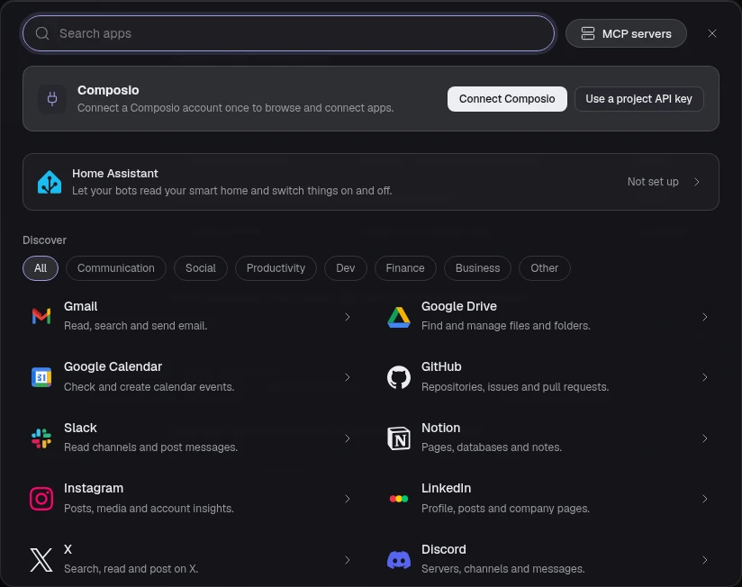
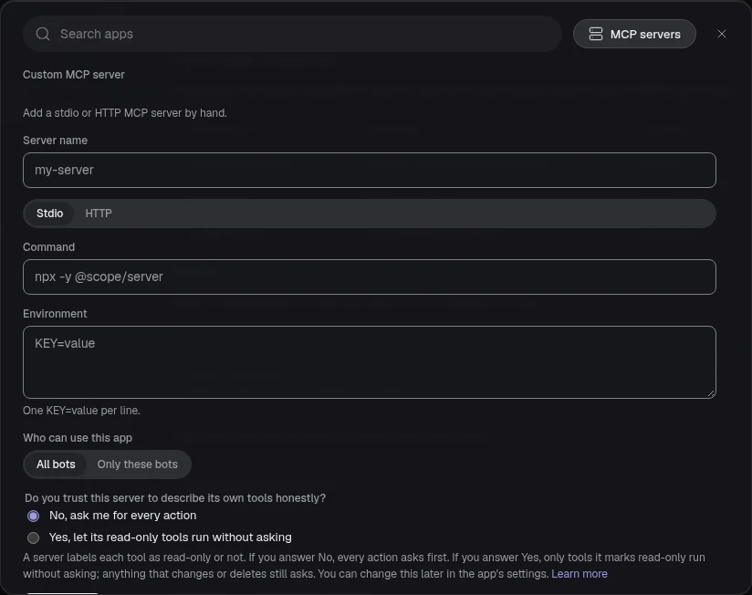
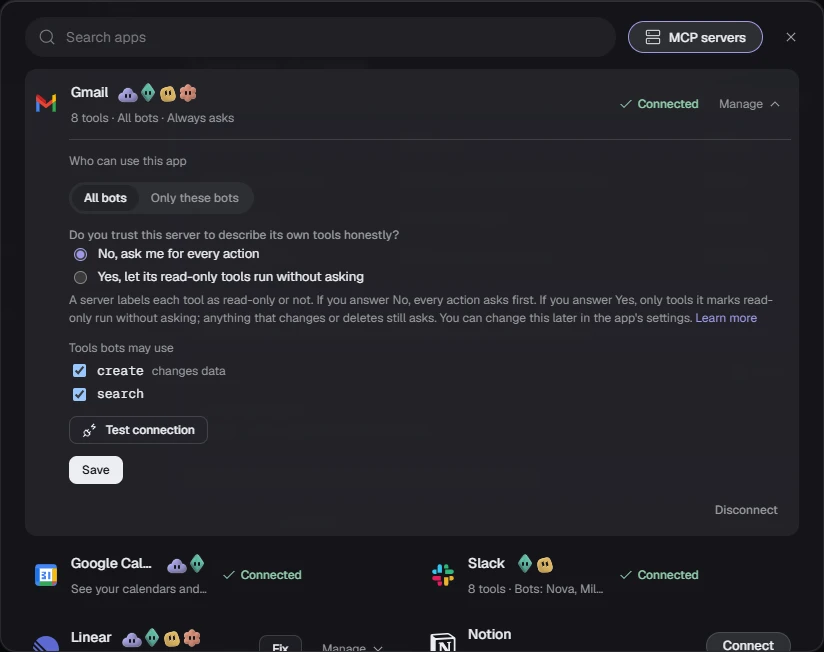
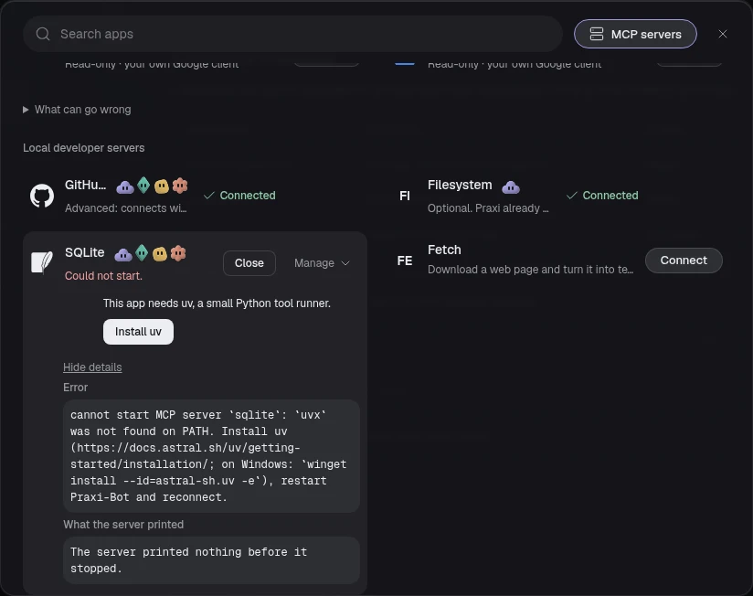

# Connecting apps (the Apps dialog)

Open **Apps** from the left rail or the command palette (`Ctrl/Cmd+K`).
The main view connects apps through Composio. **MCP servers** opens the
settings for direct, local and custom MCP connections.

## Connect Composio once

Composio is an entry of the app list, with its own logo. Before you sign in it
is the first entry under **Discover**: choose **Sign in** to sign in in your
system browser, or **Use a key** to paste a project API key. The daemon
validates the key and stores it in its secret store. Once signed in, Composio
moves to **Your apps**, and when Composio supplies the organization or project
name its entry shows **Connected as** followed by that name.

## Connect and manage an app

1. Find an app in **Discover**. **Popular** comes first (Gmail, Google
   Calendar, Google Drive, Outlook, Slack, WhatsApp, Telegram, Notion, GitHub
   and a few more), then the other apps by category. Use search, the category
   filters and **Show more** to browse the catalog.
2. Open the app's page to see its actions and select **Connect**.
3. Finish authorization in your browser. Praxi checks the authorization with
   Composio until it succeeds or expires.

This also works when the bots run on a paired host. The browser opens on the
desktop you use, Composio receives the response, and the host polls Composio
over HTTPS. The browser never needs to reach the host.

Open the app again under **Your apps** to test, disconnect or change bot
access. Praxi displays the account name when Composio supplies an alias or a
read-only test identifies it. **Test connection** checks the bound
authorization. Gmail, Google Drive, Google Calendar and GitHub also have
read-only tests that can show a name or up to three samples to the owner.
Bot access and approval rules apply to the tools exposed by Praxi's existing
Composio integration. Tool inputs and results pass through Composio.

### What asks before it runs

Each action on an app's page has a class next to it. Praxi decides the class
from what Composio says about the action (its request method, its tags and the
words in its name), never from what a bot says. An action is **Read only**
only when Composio says it is a `GET` or `HEAD` request, or marks it read-only.
When Praxi cannot tell (a `POST`, or no request method), the action counts as
**Changes things**, even if its name starts with `list` or `get`.

| Class | What it does | Does it ask? |
|---|---|---|
| **Read only** | Looks things up (list, get, search, fetch). | No card on any level that allows reading. |
| **Changes things** | Creates, sends or updates something. This is also the default for an unclear name. | Follows the bot's access level: it asks on Ask and Balanced, and runs on Full. |
| **Deletes** | Deletes, removes or revokes something. | Follows the bot's access level, like the row above. |
| **Moves money** | Pays, charges, buys, subscribes, transfers, refunds, invoices, orders, changes billing or upgrades a plan. | Always asks, on every level, Full included. No "always allow" covers it. |

On Full, a write or delete runs without a card, in the same runs the Full
level covers everywhere else (see "Full access: asks only before spending
money" in [Chatting and approvals](chatting-and-approvals.md)). Before Full, a
bot that has read untrusted content (a web page, a mail) is also asked before a
write, delete or payment that would send data out; that check does not apply to
reads.
Names with a charge or payment word that only look something up over a `GET`,
such as `list charges`, stay **Read only**. Names that share, invite, forward,
reply, post or change roles, permissions or members (`get invite link`) count
as **Changes things**; only a plain `list` or `search` over a `GET` (`list
members`) stays **Read only**. A name that mixes a lookup with a payment
verb, such as `get and pay`, counts as **Moves money**.

Use **Sign out** on the Composio entry under **Your apps** to suspend access
to all Composio apps. Praxi keeps your app settings, including bot access.

## Home Assistant

The **Home Assistant** card in the main view sets up your smart home without
editing a file: address, long-lived access token, **Save and test**, which bots
may use it and which services may run without a card. See
[Home Assistant](home-assistant.md). (The **Home Assistant** MCP server in the
catalog below is a different, optional connection.)

## REST APIs

Choose **REST APIs** in the top bar to connect any web service that publishes an OpenAPI
document, and turn on its operations bot by bot. See [Connect a REST API](rest-apis.md).

## MCP servers

Choose **MCP servers** in the top bar for direct and self-managed connections:

- **Remote MCP servers:** Install a direct OAuth server such as Atlassian,
  Linear, Notion or Stripe, then finish sign-in in your browser. Manage
  existing remote servers here.
- **Google with your own setup:** a guided setup that connects Google's own MCP
  servers (Gmail, Drive, Calendar) with a client you create yourself. See
  [Google Workspace](google-workspace.md). The Gmail, Drive and Calendar apps in
  the main list use Composio and need no setup.
- **Add your own MCP server:** give the **Server URL (HTTP)**; the name is
  suggested from it. Under **Sign-in** choose **None**, **Access key** (a
  header, `Authorization` by default; the key goes to the secret store, never
  to `mcp.toml`) or **Sign in with the browser**. **Run a local command
  instead (stdio)** folds out the command and its `NAME=value` settings;
  values whose name contains KEY, SECRET, PASSWORD or similar go to the secret
  store too. Pick which bots may use it and whether to trust its read-only
  labels (the **?** explains). **Add server** saves it switched off, with an
  **Off** state and **Turn on** in the list; **Test connection** saves it,
  turns it on, lists its tools without running any, and turns it off again if
  that fails. Mistakes are named under the field as you type (a password in
  the address, a name in use, a line that is not `NAME=value`). See
  [MCP servers](mcp-servers.md) for the underlying `mcp.toml` format and
  security flags.
- **Local developer servers:** Local stdio servers from the built-in catalog
  that need no API key (such as **Filesystem**, **Playwright**, **Fetch**,
  **Context7**, **SQLite**, and **Google Drive**), along with any local servers
  you have already added. Servers that require a folder (like **Filesystem**)
  ask for the single **Folder the bot may read and write** inline — Praxi
  refuses its own data and credential folders.
- **Services with an access token:** Catalog servers that authenticate with a
  personal API key or token (such as **GitHub**, **Brave Search**, **Sentry**,
  **Todoist**, **Obsidian**, **Home Assistant**, **Exa**, **Tavily**,
  **Firecrawl**, **PostgreSQL**, **Slack**, and local **Notion**). Clicking
  **Connect** opens password fields under the row with a **Get API key** link
  where available. Secrets are saved in your OS keychain and never shown again.

## MCP server status

A new direct OAuth connection stays in **Signing in** until authorization
finishes. If you cancel or it times out after five minutes, Praxi removes
the unfinished server entry.

Status badges on MCP servers mean:

| Badge | Meaning |
| --- | --- |
| **Connected** | Server session is up and its tools are available to allowed bots. |
| **Connecting** | Daemon is starting the server or establishing the session. |
| **Sign-in required** | Remote HTTP server needs an OAuth sign-in before tools can run. |
| **Disconnected** | Server is not currently connected; use **Reconnect** under **Manage**. |
| **Error** | Last start or connection attempt failed; details appear below the row. |
| **Quarantined** | Server failed repeatedly and was paused until you fix it and press **Reconnect**. |

## Managing connections and signing out

Under **MCP servers**, hover or focus a connected server row and click **Manage**. Rows that need attention (such as `Error`,
`Sign-in required`, `Sign-in expired`, or `Quarantined`) always keep **Manage**
visible.

### Direct OAuth and MCP servers

What each app needs to connect (a plain sign-in, a client you create, or a key)
is listed in [What you need to connect each app](app-catalog.md).

Inside **Manage** you can:

- **Choose which bots may use the app** under **Who can use this app** and click
  **Save**.
- **Decide whether the server may label its own tools** under **Do you trust
  this server to describe its own tools honestly?** With **No** (the default),
  every action asks first; with **Yes**, only the tools the server marks
  read-only run without asking. See [MCP servers](mcp-servers.md) for how these
  labels are used, and [Connect your apps](connect-your-apps.md#when-an-app-changes)
  for what happens when a tool changes after you approved it.
- **Turn individual tools on or off** under **Tools bots may use** (this writes
  `tool_exclude` in `mcp.toml`). Tools that modify or send/delete data are
  labeled **changes data** or **can delete or send**. If you configured a custom
  `tool_allow` list in `mcp.toml`, Praxi notes that tools are limited by that
  allow-list.
- **Sign out** (HTTP OAuth servers when signed in): clears the stored OAuth
  tokens from the daemon's secret store while keeping the server configured. The
  server moves to **Sign-in required** until you click **Sign in** again.
- **Reconnect** (when `Error`, `Disconnected`, or `Quarantined`): tells the
  daemon to restart or reconnect the server immediately.
- **Disconnect**: asks for confirmation (**Disconnect this server?**), then
  removes the server configuration from `mcp.toml`.
- **Test connection**: starts the server and lists its tools, without running
  any of them (see [Test connection](connection-test.md)).

## Per-bot access

Each Composio app and MCP server can be shared with all bots or restricted to
specific bots. For Composio, open the app page, choose who can use it and click
**Save**. The following controls apply to MCP servers. Connected rows show up to four bot avatars (plus
`+n` when more bots have access) alongside **All bots**, **No bots**, or
**Bots: …**.

You can change access from two places:

1. **From Apps:** open **Manage** on the server row, choose **All bots** or
   **Only these bots**, tick the bots that should see it, and click **Save**.
2. **From a bot's settings:** open the bot's profile (or the new-bot dialog),
   scroll to **Apps**, and toggle each connected server on or off. Unticking an
   app that was open to all bots limits it to your other bots.

A few important rules:

- Selecting **Only these bots** with none ticked (**No bots**, stored as
  `bots = []`) gives access to **no bot**, never every bot.
- Unassigned bots do not see the server's tools and cannot call them.
- If the server's bot access changed elsewhere while your panel was open, Praxi
  refuses to silently overwrite it and refreshes to show the current state.
- Connecting an app and granting a bot access does **not** bypass approvals:
  destructive or write tools still ask for permission (see
  [Security model](security.md) and [MCP servers](mcp-servers.md)).

## Troubleshooting a stuck or failed connection

### OAuth sign-in is stuck on "Waiting for the browser sign-in…"

- **Cancel and retry:** click **Cancel** in the sign-in card at the top of the
  dialog. A sign-in nobody finishes expires after **5 minutes** and is cleaned
  up automatically; a brand-new app that never signed in is removed again.
- **Praxi runs on a server (or a paired host):** the sign-in page still opens in
  the browser of the computer you are at. The desktop app catches the answer on
  a temporary local port and passes it to the server over the paired, encrypted
  link, so there is nothing to copy. This needs the desktop app, and this
  computer must be confirmed as an administrator of the server (see
  [Remote host](remote-host.md)). If the app cannot catch the answer (for
  example you use Praxi in a plain browser tab), the card says so and shows one
  box: after you sign in the browser lands on a page that does not open and
  whose address starts with `http://127.0.0.1:`. Copy that full address and
  paste it into the box, then press **Finish sign-in**.
- **Browser window did not open:** the card says so and offers **Open the page
  again** and **Copy the link**; the sign-in keeps waiting.
- **GitLab returns a namespace error:** GitLab requires the MCP server to be
  enabled on your top-level group (`group[mcp_server_enabled]` in the group's
  General settings).

### Composio sign-in is stuck or the catalog will not refresh

- **Stuck on "Signing in":** the flow times out after **10 minutes**. Open the
  app page and choose **Cancel**, then **Connect** to start again.
- **"The app list could not be refreshed: showing the saved one":** you are
  offline, Composio is rate-limiting requests, or your Composio sign-in expired.
  Click **Try again** once you are back online. If sign-in expired, link again
  from the Composio entry in the list.

### "The page for an app could not be prepared"

The connect sheet names the reason, and **Details** shows the exact text:

- **Only the Praxi desktop app on this computer can connect apps:** the owner
  confirmation is missing. Open Praxi on this computer and connect from there.
- **Composio does not offer this app:** pick another app from the list.
- **Praxi refused to connect it** (for example the account does not match the
  one saved before): **Disconnect** the app, then **Connect** again.
- **Composio is busy / could not be reached:** wait a minute, check the
  connection of the computer the bots run on, then **Try again**.
- **Composio no longer accepts the sign-in:** return to the account card and
  link Composio again, then retry from the app page.

### A local MCP server shows "Error" or "Quarantined"

Failed MCP servers display a specific hint directly under the row together with
a **Show details** toggle containing the **Error** message and **What the server
printed** (`stderr`):

- **Missing runtime (`Node.js`, `uv`, `pipx`, `docker`):** for **Node.js** and
  **uv**, Praxi shows an inline **Install** prompt (or you can install them from
  their official sites and restart Praxi-Bot), then press **Reconnect**.
- **Missing folder (`Filesystem`):** enter the full path to the single folder
  the bot may read and write and click **Save and connect**.
- **Server stopped while starting:** click **Show details** to read `stderr`
  (for example, Docker installed but the Docker daemon is not running), fix the
  underlying issue, and click **Reconnect**.
- **Timed out:** the first launch can take longer while `npx` or `uvx` downloads
  packages. Wait a moment and press **Reconnect**.
- **Missing or invalid secret / settings:** check your server configuration or
  re-add the server with a fresh token, then press **Reconnect**.
- **Quarantined:** the daemon paused the server after repeated failures. Fix the
  cause shown in **Show details**, then press **Reconnect** to clear the
  quarantine.
