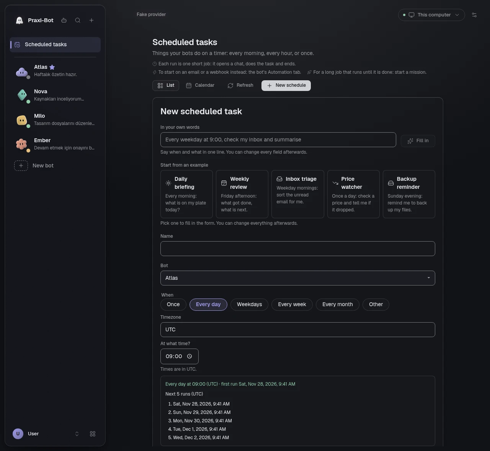
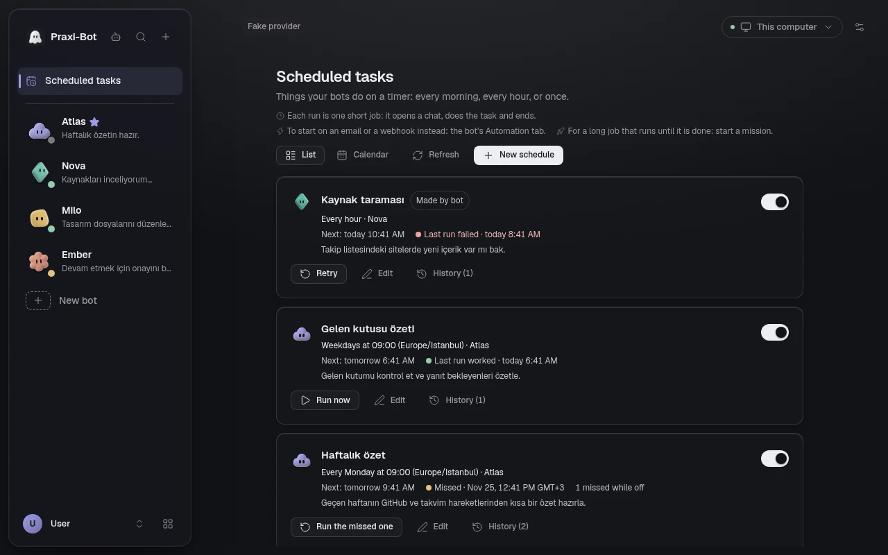
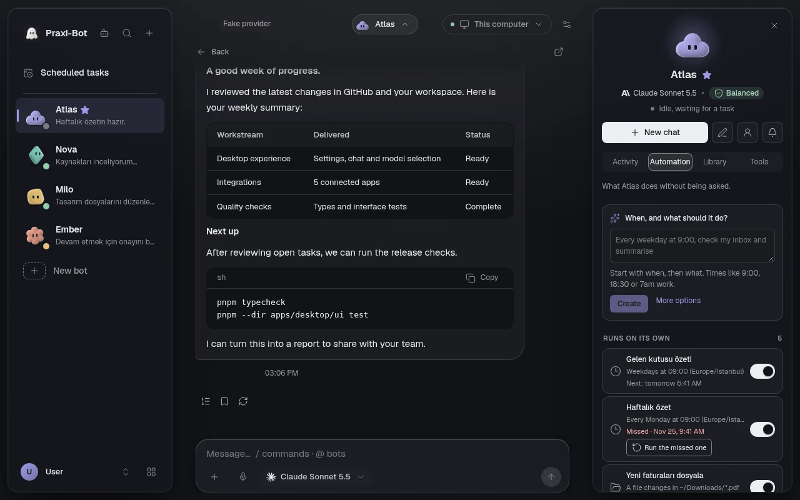

# Automate things

A **scheduled job** lets a bot do something by itself at the times you choose. For example: "every morning, tell me what is on my plate today". You set it up once. After that it runs on its own.

## Make your first job

1. Click **Scheduled tasks** in the left rail.
2. Press **New schedule**. The window **New scheduled task** opens.
3. In **In your own words**, write the job in one sentence and press **Fill in**. Or click one of the small **Examples** chips. It fills in the form. You can change everything afterwards.
4. Under **When** choose **Once**, **Every day**, **Weekdays**, **Every week**, **Every month** or **Other**, then pick the time. One line sums it up, for example "Every weekday at 09:00, Istanbul". **Next 5 runs** unfolds the next times. Check that this is what you meant.
5. Pick the **Bot** and check the **Name**.
6. Check **What should the bot do?** This is what the bot is asked to do each time. Write it in your own words.
7. **More options** holds **Tell me when it ran** (**Every time**, **Only if something goes wrong** or **Never**), the time zone and the rarer settings. It is folded; its title shows what is chosen.
8. Press **Create**.

## Three examples you can copy

### 1. Daily briefing

- **How often?** Every day, at 08:00.
- **Prompt:** "Summarise my unread email and today's calendar in five short bullet points. Put the most urgent thing first."
- Needs: your email and calendar connected. See [Connect your apps](connect-your-apps.md).
- Safe because: the bot only reads and writes a summary.

### 2. Weekly review

- **How often?** Every week, Friday at 17:00.
- **Prompt:** "Look back at this week's chats and notes. List what got done, what is still open, and three things to start with on Monday."
- Needs: nothing extra.

### 3. Price watcher

- **How often?** Every day, at 12:00.
- **Prompt:** "Open the product page I name below, read the current price and tell me if it is lower than yesterday. Product page: (paste the link here)"
- Needs: replace the text in brackets with your link. The bot opens that page, so in **Careful** mode it may ask first.

The same list also has **Inbox triage** and **Backup reminder**.

## Say the time in words

Choose **Other** and type the time in your own words. For example "every weekday at 9" or "her gün 09:00". English and Turkish work. A fixed set of rules reads your words, not an AI model. You always see what was understood before you press **Create**.

## If the computer was off

Jobs only run while Praxi is open on an awake computer. Under **If the computer was off at the planned time** you choose:

- **Skip it and wait for the next time** (the default).
- **Run once when the computer is back**.
- **Catch up: run every missed time (up to 10)**.

If you want jobs to run at night, use a server. See [Run it on this computer or on a server](local-or-server.md).

## Run now, edit, pause, delete

On each job you can press **Run now**, **Edit** or **Delete**. A job that failed or was missed has **Retry**. Deleting asks you to confirm.

## Safety

- A job has the same permissions as its bot, never more.
- If a job needs your OK, it waits in **Needs you**. It does not go ahead alone. If nobody answers, the answer becomes no.
- Web pages and emails a job reads are information, never orders.
- Spending limits you set also apply to jobs.
- On a bot at the **Full** level, a job or rule **you** wrote runs without asking (money still asks). One that a bot made, or whose author is unknown, keeps asking until you press **This is mine** on it. See [Full access for your own schedules and triggers](chatting-and-approvals.md#full-access-for-your-own-schedules-and-triggers-who-wrote-it).

More: [Scheduled jobs in plain words](schedules.md) and the [technical reference](scheduled-tasks.md).

## Start a bot from outside

A **webhook** starts this bot when something else calls an address: GitHub, a form, or a switch at home.

1. Open the bot panel and choose **Automation**.
2. Name the webhook and, if you want, write what the bot should do with the data. Press **Create webhook**.
3. Copy the secret immediately. Praxi shows it only this once.
4. Praxi listens only on this computer. Point a tunnel you choose (Cloudflare Tunnel, or ssh) at `127.0.0.1`. Do not open a new port on your router.

Each call sends the time in `X-Webhook-Timestamp` and `X-Signature-256: sha256=` plus the HMAC of that time, a dot, and the raw body. The same signed call works once, and only within 5 minutes. The body can be at most 64 KB. More than 30 calls a minute are refused. The text is data, never an order. The bot still asks before it acts, and that question shows up as a notification.

**Send a test** starts one run from the app. It does not use the outside rate limit.

More: [Incoming webhooks](incoming-webhooks.md).
