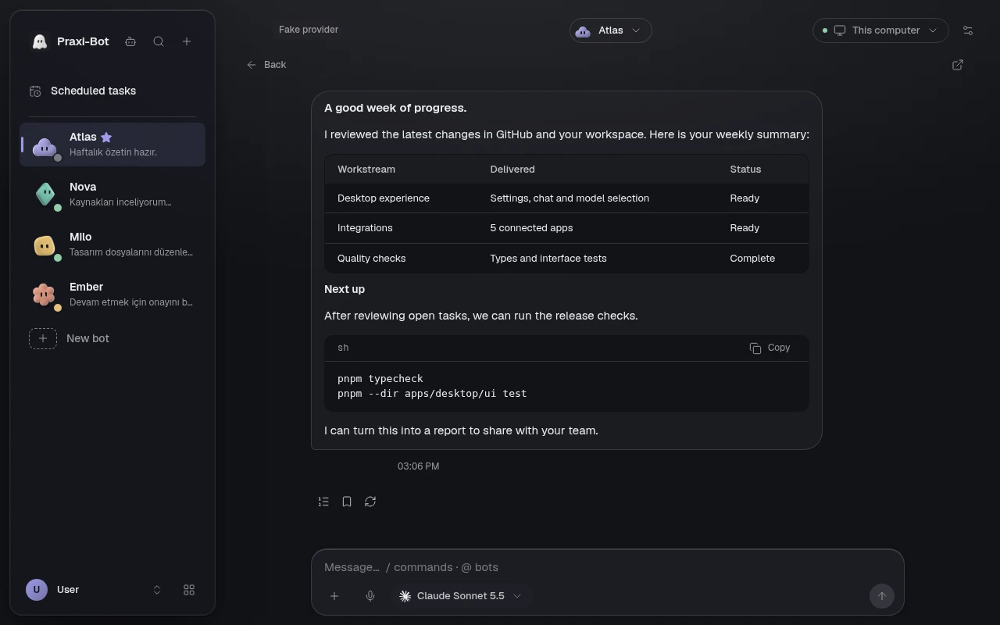
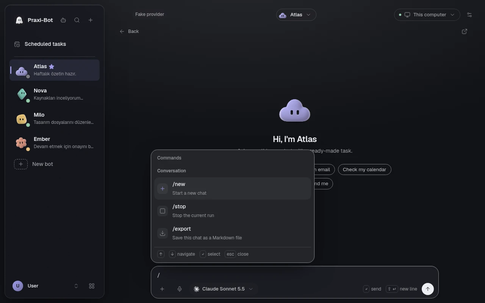
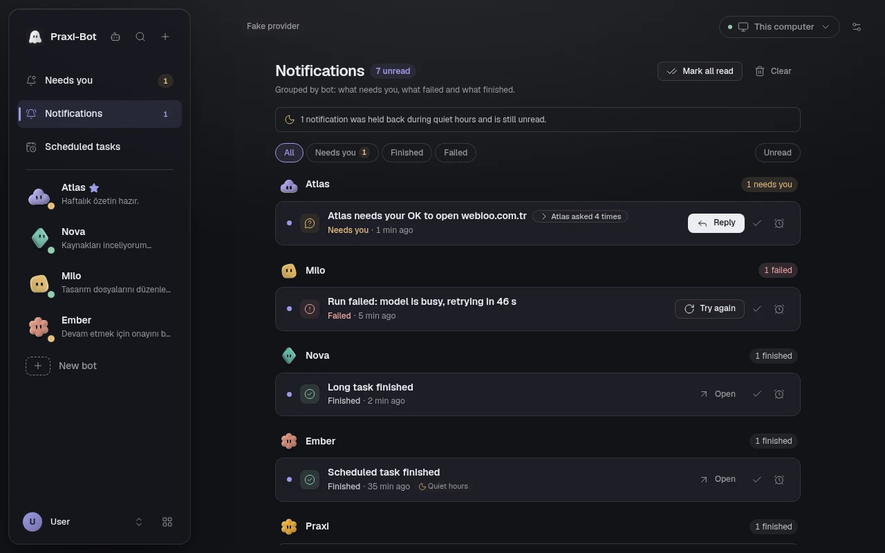

# Chatting and approvals

## Talking to a bot

Every conversation is a **chat** with one bot. Chats are kept, so you can come
back later. A message starts a **run** (also called a turn): the bot thinks,
calls tools, and streams its answer back. You can follow it in the desktop app,
in a terminal, or in Telegram.



From the terminal:

```sh
bot chat <bot-id> "Summarize the PDF files in ~/Downloads"
bot chat <bot-id> "and now rename them by date" --chat <chat-id>   # continue
```

`bot chat` creates a new chat unless you pass `--chat`. It prints the answer as
it streams. Tool calls, approval requests and routing decisions are printed to
stderr, the answer text to stdout (so `bot chat ... > answer.txt` works). With
the global `--json` flag stdout becomes NDJSON, one event per line.

### Sending a message while the bot is busy

If a turn is already running in the chat, `--mode` decides what happens:

- `queue` (default): the message waits and runs as the next turn.
- `steer`: the message is added to the running turn so you can redirect the bot.

### Attaching files and images

Upload a file with `POST /v1/chats/{id}/attachments` (raw body, `?name=` for the
display name) and pass the returned ids as `attachment_ids` when you send the
message; the text may then be empty. The file type is detected from its content,
not its name:

- Images (PNG, JPEG, GIF, WebP, up to 5 MB) go to the model as pictures. A model
  without vision support is skipped or the turn reports that no model supports it.
- PDF, Word (`docx`), Excel (`xlsx`) and PowerPoint (`pptx`) files and plain text
  files (up to 15 MB) are read once, secrets are masked, and the text (at most
  about 60 KB) is given to the model as data, never as instructions.
- Audio, video, archives, legacy Office files and other binaries are refused with
  a clear message; nothing speech-to-text is available yet.

A message carries at most 6 files. Files are stored in the data directory under
`attachments/`.

### Voice call (desktop app)

Click the phone button (**Start voice chat**) in the desktop composer to talk
hands-free. The app records each turn in memory, transcribes it through the
dictation endpoint you configured in **Settings → General**, sends it as an
ordinary chat message, and reads the reply aloud sentence by sentence. Approvals
stay click-only on the card in the chat. See [Voice call mode](voice-call.md).

### Slash commands

When the router is enabled, `/stop` (stop the current run), `/new` (start a new
chat), and `/workflow <name> key=value ...` (run a saved workflow directly, see
[Workflows](workflows.md)) are handled directly without reaching the model.

In the desktop composer, typing `/` at the start of a message opens a command
menu that also includes local commands handled by the app itself (never sent to
the bot): `/export` (download the open chat as Markdown) and app shortcuts
`/help`, `/settings`, `/vault`, `/models`, `/apps`, and `/schedules`. In Telegram there
are extra commands, see [Telegram](telegram.md).



### Managing chats (desktop app)

In the desktop app, the **left rail lists bots only** (not individual chats).
Clicking a bot opens its most recent non-archived chat, or its empty state if
it has none yet.

Each bot's chats live in the right-hand **bot panel**: click the bot chip in
the title bar to open the panel, then switch to the **Library** tab under
**Chats**. Once a bot has 6 or more chats, a **Search chats** box appears above
the list.

Each chat row has an overflow (`...`) menu backed by `PATCH /v1/chats/{id}` and
`DELETE /v1/chats/{id}`:

- **Rename**: edits the chat title inline (1–120 characters; `Enter` saves,
  `Esc` cancels).
- **Pin / Unpin**: pinned chats float to the top of the list with a pin icon.
- **Archive / Unarchive**: archived chats move into a collapsible
  **Archived (N)** group at the bottom of the list (expanded automatically while
  searching if archived chats match).
- **Delete**: asks for confirmation and permanently deletes the chat and its
  messages. Deletion is blocked while a run is active in that chat—stop the run
  first.

### Opening Praxi links (desktop app)

A Praxi link can open a bot, chat, or run from a browser or another app. The
link contains the ID of something that already exists. Use the lowercase,
hyphenated ID in one of these forms.

| Link | What opens |
| --- | --- |
| `praxi://bot/<id>` | The same view as selecting that bot in the left rail |
| `praxi://chat/<id>` | That chat |
| `praxi://run/<id>` | That run's step list and status |

The link looks on the computer already selected in Praxi. If the item has
been removed or is on another computer, Praxi shows a message. Opening a link
doesn't send a message, start a run, or answer an approval. See
[Install and first run](install.md#desktop-link-support) for platform support.

### Copying messages and Markdown export

- **Copy a message**: hovering or focusing any user or assistant message reveals
  an action row under the bubble with a **Copy message** button (showing a brief
  **Copied** confirmation). It copies only the user-visible text (plain text or
  Markdown), stripping internal attachment markers and never copying raw
  internal tool JSON. Individual code blocks in assistant replies also have
  their own copy button.
- **Export a chat as Markdown**: type `/export` in the desktop composer to
  download the open chat as a `.md` file named after the chat title (or the bot
  name when untitled). The file includes user and assistant messages with UTC
  timestamps; nothing is sent to the bot.

### Unread markers

The daemon does not store read state; the desktop app keeps per-server,
per-chat read timestamps locally (with a baseline recorded the first time the
app sees a server, so existing chats do not all start unread):

- **Left-rail unread dot**: a bot shows an unread dot when any of its chats has
  a finished run or pending decision newer than its last read timestamp.
- **"New messages" divider**: opening a chat with unseen assistant replies
  places a **New messages** divider above the first unseen entry. Scrolling past
  the divider dismisses it, and the chat is marked read while the window is
  visible and focused.

### Keyboard shortcuts and "What's new"

- **Keyboard shortcuts dialog**: press **`?`** anywhere when no text field has
  focus (or open it from the command palette with `Ctrl/Cmd+K` → **Keyboard
  shortcuts**, from the profile menu, or by typing `/help` in the composer). The
  dialog lists global shortcuts (`Ctrl/Cmd+K` command palette, `?` shortcuts,
  `Ctrl/Cmd+,` settings, `Ctrl/Cmd+F` find in chat, `Esc` close side panel,
  `Shift+Esc` exit live-view keyboard focus, and your configured stop hotkey),
  composer shortcuts (your configured send and newline keys, `Up`/`Down` message
  history recall, slash/mention menu navigation), composer slash commands, and
  dialog navigation keys.
- **"What's new" card**: after an app update, the desktop app shows a **What's
  new** modal once per installed version. The notes are bundled inside the app
  (English, Turkish, and German)—nothing is fetched over the network. A fresh
  install that has not completed onboarding records the version silently instead
  of showing the card.

### Sending while the host is offline

- **This computer (local daemon)**: if sending a message fails because the
  connection to the local daemon is refused or unreachable, the desktop app
  probes `/v1/health` to confirm the service is actually down (a slow answer or
  timeout never triggers a retry, so a live daemon never gets a duplicate
  message), shows *"Starting this computer's Praxi service…"*, starts the local
  daemon automatically, and sends the message once it is ready.
- **Paired remote host**: the desktop app cannot power on or start a remote
  server. Your text stays in the composer as a draft, and the app displays
  **"The server is offline"** with a **Retry** button once the server is back
  online.

### Questions

A bot can ask you something with a question card (`ask_user`). In the CLI you
see `[question]` with numbered options and answer with:

```sh
bot answer <call-id> "the second one"
```

## Approvals

When a bot wants to do something its policy says needs your say-so, the run
**waits** and an approval request appears: a card in the desktop app, inline
buttons in Telegram, or a `[approval needed]` line in the CLI.

```sh
bot status                              # how many approvals are pending
bot approve <tool-call-id>              # approve this one call
bot approve <tool-call-id> --scope this_chat
bot approve <tool-call-id> --deny --reason "not that folder"
```

The reason you give on a denial is passed to the model so it can try something
else.

### How far an approval reaches

| Scope | Meaning |
| --- | --- |
| `once` (default) | This single call only |
| `this_chat` | This tool, for the rest of this chat |
| `always` | This tool, for this bot, remembered permanently |
| `always_category` | The tool's whole category (for example every `fs` tool) for this bot, remembered permanently |
| `run_control` | Only on a desktop input card that offers "This task: <program>": typing, keys, values and dragging in that one program until the run ends (see [security](security.md)) |

"Always" choices are stored as **grants**. Review and remove them:

```sh
bot grants list <bot-id>
bot grants revoke <bot-id> --tool fs_write
bot grants revoke <bot-id> --category fs
```

After a revoke the next matching call asks again. Revocations are written to
the audit log. Grants never lift the absolute floors below.

## Permission levels

Every tool belongs to a **category**, and every category has a **level** for
each bot.

| Level | What happens |
| --- | --- |
| Deny | The call is refused, the bot is told |
| Ask | The run pauses until you approve or deny |
| Allow | The call just runs |
| Allow with limits | Meant as "allowed within limits"; the current resolver treats it as Allow |

Categories: `fs` (files), `shell` (commands), `desktop` (clicks and typing in
apps), `browser`, `accounts` (connector accounts), `messaging` (email, chat),
`money` (payments, purchases), `system` (settings, installing software),
`remote` (another computer) and `script` (code execution). The internal
`meta` category (asking you a question, keeping a to-do list) is always allowed.

### The four presets

| Preset | In plain words |
| --- | --- |
| `approve-destructive` (default, recommended) | Every category is set to Ask, but **reading tools are waived** (see below). Anything that changes files, clicks or types in apps, runs commands or sends messages asks first |
| `read-and-draft` | Like the default; files and browser are explicitly Ask. Sending asks |
| `read-only` | Every category is Deny. The bot can only use tools that ask nothing of the permission system, such as asking you a question |
| `full` | Every category is Allow: no prompts, except for the floors below. Use it only for bots in a sandbox you trust |

"Reading tools are waived": the daemon lets tools that only read (for example
`fs_read`, `fs_list`, `browser_snapshot`, `desktop_get_state`) skip a policy-level
"Ask". This does **not** apply to `read-only`/Deny, and never to the floors.

> The wording of presets in this guide follows the code. The preset names
> `read-and-draft` and `approve-destructive` differ only slightly today; both
> ask for file and browser actions.

### Absolute floors

These hold no matter what preset, grant or profile says:

1. **Money always asks.** A `money` action is never auto-allowed.
2. **The never-list always asks.** Shell commands that are catastrophic and
   irreversible are recognized by parsing the command (not by loose string
   matching), including inside `sh -c`, `powershell -Command`, `sudo` and
   pipelines: formatting disks, `diskpart clean`, `mkfs`, `dd` onto a device,
   `bcdedit`, bootloader installers, and recursive deletes that target a
   protected location (filesystem or drive root, your home folder, system
   directories such as `C:\Windows`, `Program Files`, `/etc`, `/usr`). Deleting
   `/tmp/x` recursively is not on the list.
3. **Subagents never exceed their parent bot.**

Grants ("always allow") cannot waive a floor.

### Egress after a read

Once a run has read untrusted or private content, a tool that can send data off
the machine asks even if a grant or the read shortcut would have allowed it.
Desktop typing, clicking, and launching, browser scrolling and tab changes, and
mailbox reads, searches, and mark-read are in that set. The card says what was
read and shows the exact outgoing query, URL, or body, including every
recipient, with the tail reachable by scrolling, and the destination host.
Approving that card allows that one send. It does not create a standing grant.
A later message in the same chat still asks while the earlier answer is in the
conversation the model sees. A click, scroll, or drag does not send data off
the machine, so it stays allowed after a read; typing, pasting, launching, and
filling a page still ask. Writing or moving a file does not count as reading
private data. Search against the configured provider stays
prompt-free when the run has only untrusted content and has not read private
data. The bot form has an explicit, off-by-default setting that skips this ask
for that bot. Deny rules and the floors above still win. A run that has not
read anything behaves as before.

### Full access: asks only before spending money

A bot on the **Full access** level (or any bot without its own level while the global
level is Full access) asks the owner for **nothing except spending money**. Shell
commands, file changes and deletes inside the allowed folders, installs, browsing,
forms, sign-ups with the bot's own e-mail address, sending e-mail and messages and
connector writes all run without a card. That holds for runs you typed, for the run of a
schedule you wrote and for runs a trigger you wrote, or a webhook or inbound mail of yours,
started (see [who wrote it](#full-access-for-your-own-schedules-and-triggers-who-wrote-it)).
Every call the level let through is written to the audit log as `approval.auto_allowed`
with the reason `mode.full.policy`, the tool and who started the run.

What still asks, and why:

* **Money.** A tool that declares payments, a shell command that starts a known payment
  program (`stripe`, `paypal`, `lncli`, ...) or names a payment API host, a connector
  action of a payment app (or with a payment verb such as `charge`, `payout`, `checkout`),
  and a managed-browser page that shows checkout (a checkout or payment URL, a card
  field in the page or in any frame of it, a frame of a payment provider such as Stripe,
  PayPal, Adyen, Braintree, Square or Klarna, or a payment button). A quoted, escaped or
  wrapped program name (`"stripe"`, `\stripe`, `sudo -u root stripe`, `timeout 10 stripe`)
  counts like the plain one, and so does one nested in another command: a command
  substitution (`$(...)`, backticks, `${...}`), the code argument of `python -c`, `node -e`,
  `ruby -e`, `perl -e`, `php -r` or `pwsh -Command` (also `-EncodedCommand`),
  `Invoke-Expression` / `Start-Process`, `ssh host <cmd>`, `docker` / `kubectl exec ... <cmd>`,
  or text piped into a shell. A page script (`browser_eval`) that names a payment API
  (`fetch`, `XMLHttpRequest`, `sendBeacon`) asks on any page, not only on a checkout; and a
  script that has not been approved for a payment runs with requests to payment APIs blocked at
  the browser's network until the page changes. The page is checked for every browser tool, including
  `browser_eval` and the `pc_browser_*` tools of your own computer (there by the page address
  and the button's label only), and for replayed workflow browser steps. The same read applies to the command or arguments a coding CLI
  engine hands over for its own tool, in any field, and to a program started on your
  computer. The card is once-only and bound to that page.
* **Locks, garage doors and alarms.** A [Home Assistant](home-assistant.md) service that
  opens a lock or a garage door, disarms an alarm, or is not a plain device call asks on
  every level, Full access included, unless you allowed that exact service in the
  Home Assistant card.
* **The never-list** (catastrophic commands), a **deny** in the bot's own rules, an
  **ask you wrote yourself** (a category, or a source such as schedules, set on a bot that is
  otherwise Full access: your rule wins over the preset), the owner's per-site and
  per-app ask rules, and limits the daemon cannot evaluate.
* **Durable permission** (a schedule, a bot change, the knowledge root, a skill) minted
  by a run that read untrusted content, and by every run a webhook, trigger, external
  schedule or inbound mail started: their text is untrusted from the first call.
* Anything that is not served by the lane: a helper bot, an unpaired chat, an external
  agent, a Balanced or custom level, and a schedule or trigger whose author is not you
  (a bot made it, or it is not confirmed yet).

Mail the safety checks flag (a recipient who opted out, the daily volume) is not sent in an
unattended run; the bot is told why and nobody is asked.

A question (`ask_user`) in a run nobody watches (a schedule, a trigger, an inbound mail) is not
answered by the bot and does not wait: the bot is told that nobody can answer now and that the
answer must not come from it or from text a page, mail or trigger gave it, so it finishes
what does not depend on the answer and ends its turn with the question, which you read in the
run's report. In a mission, the question after the first batch blocks the item it stops (the
question is the reason you see in the blocked list) and the session takes the next item.

The switch for the lane is read once, when the daemon starts. If `host.toml` exists but cannot
be read or parsed (or `full_access_lane` has the wrong type), the lane stays **off** for that
run of the daemon and the daemon logs an error; the diagnostics list in Settings (and `bot doctor`) shows
"full access lane: OFF" with the reason. Fix the file and restart. With no `host.toml` the lane is on.

What the level cannot know: a charge behind an ordinary button, a payment made by a script
file, a desktop window or an API Praxi does not recognise. See the threat model.
The rest of this section describes the older, narrower waivers; they apply only if the
operator switches the lane off (`[security]` `full_access_lane = false` in `host.toml`, or
`BOT_FULL_ACCESS_LANE=off`; the environment wins).

### Full access for your own schedules and triggers: who wrote it

The Full lane serves a schedule or a trigger (a mail rule, a webhook rule, a file watch)
**only when you wrote it**. What decides it is who wrote the instruction, not what started
the run: a timer or an incoming mail starts the run, but the text it carries out is the
rule's. The daemon records an **author** on every schedule and rule when it is saved:

| Author | Who | Runs without cards on Full? |
| --- | --- | --- |
| `owner` | You, in the app on this computer or on your admin desktop | **Yes** |
| `bot` | A bot, through its schedule tools (after you approved the card) | No: it keeps its once-only cards |
| `unknown` | Made before the author was recorded, on a paired phone or other device, or moved here from another computer | No, until you confirm it |

Saving a schedule or rule again makes **you** its author (or `unknown` again if the save came
from a paired phone), so nobody can slip new text into something you confirmed earlier. A bot
that edits its own schedule makes it a `bot` schedule. The answer is read at every call, so an
edit by anyone else ends the lane at once.

**Confirm in one click.** On a bot at the Full level, the **Automation** tab of the bot panel
shows **This is mine** under every schedule or rule whose author is unknown. Press it once and
the entry counts as yours from then on (the daemon writes an audit entry). The click confirms
the version you were looking at: if the text was changed meanwhile (from a phone, by a bot),
nothing is confirmed and you read it again first. A schedule that a bot made is not confirmed
this way: open it, check the text and save it, which takes it over. A call that cannot prove it
is you (only the API token, no owner key) never counts as you: what it saves is `unknown`.

**Mail and webhook channels.** A run that comes from the e-mail channel or a signed incoming
webhook you set up (not through a rule) is served only while that channel or webhook still
exists and belongs to the same bot; otherwise it keeps its cards.

**Subagents** of a run the lane serves (a run you typed, or a schedule or trigger you wrote)
inherit it, within the usual depth limit; a helper bot another bot called never does.

**What does not change.** Only the "who started it" restriction is lifted, and only for
automation you wrote. The text of a mail, a webhook or a file stays **untrusted data** (a
quoted block, and the run starts marked untrusted), money always asks, and so do the
never-list, durable permissions minted from untrusted text, the owner-account guards and the
secret rules. A bot below the Full level is unchanged: its schedules and triggers ask once for
every tool.

### Full level: working on the web after a read (owner-started runs)

The **Full** preset ("Tam") is for people who want the bot to do the work, not to
ask about every page. In a run that **you started yourself** (typed in the
desktop app, sent from your own admin desktop, or written from **your own paired Telegram chat** to your bot), reading web pages does not
make the bot ask again for each further step in the managed browser **or in the
public-web read tools** (`web_search`, `web_extract`, `web_feed`, `web_sitemap`,
`web_metadata`, and `web_scrape` where the optional scraping add-on is installed): a
search, a page, a feed or a sitemap on a new site follows the
same rule as opening that site in the browser. Opening a
page already counts as "read something untrusted"; what decides whether the bot
may keep going is whether the run also holds **your private data**: your files,
mail, memory, screens or other bots' data, also from an earlier message of the same chat or from another bot's answer. What the bot **recalled from memory**, found in your **knowledge base** or said in an **earlier reply** is private too, but its words are known to the run (as salted hashes), so only a call that **copies** one of those words or phrases asks. Private data whose text cannot be compared (a signed-in browser, a window or screen, an attached file, another bot's answer, an MCP tool's result, or a result too large to keep) makes every new site ask. Pages seen through a browser profile you named count as private too, because that profile may be signed in to your accounts. So do the pages of a bot's own browser once you took it over (for example to log in) or typed one of your stored secrets into it, and anything opened on this computer or your network (`localhost`, `file:`, a LAN address). Logins the bot made for itself with `account_register` do not count, so sign-up work stays free. The details you typed for the task (a
company name, your email address) are not private for this purpose. You gave them
so the bot can type them into forms.

| Situation | Asks? |
| --- | --- |
| No private data in the run: opens any public site (new ones too), deep pages, query strings, goes back, switches tabs, clicks, scrolls, types the details you gave it, picks options, presses keys, submits forms | No |
| Private data in the run, and it read a web page: deep pages, subdomains and forms of a site **you named** (or approved on an earlier card) | No |
| Private data in the run, and it read a web page: a new site, a search query, or a form on a page that is not yours, **when the address or text contains a word of 6 or more letters (or three words in a row) of the private data, even split by dashes or dots, percent-encoded or accented differently**, looks like a key, access code, hash or encoded string, is long (over 120 characters of address, over 239 characters of form text, 160 characters of search query), carries a `#fragment`, or the run has already sent more than about 1500 characters to the same site (a site is its main domain: `a.example.com` and `b.example.com` count as one; about 6000 characters to all such sites together, and about 18000 over all sessions of one mission) | **Yes** |
| Private data in the run and it read a web page, but nothing in the address or text comes from the private data | No |
| A mission session, or a run that read the bot's own AgentMail inbox, with nothing else private in it: the mission brief and the mail from strangers are not your private data (they still count as untrusted content), and the bot's own mail address is not copied text. Only an inbox made for the bot through AgentMail counts here: your own mailboxes (IMAP) and inboxes shared by every bot still count as private data | No |
| Types a card-like number or something shaped like a key into a page, in any run | **Yes** |
| Types an owner-stored secret (`browser_fill` with `secret`) | **Yes**, every time |
| A shell command on the bot's own host computer after it read a page that is **entirely on the allow-list** (read-only tools such as `ls`, `cat`, `grep`, `git status`, and the local build and test tools `cargo build`, `npm test`, `make`, `python build.py`, with every path inside the bot's workspace), when the run holds no private data, or only private data whose words the command does not copy; at most 60 such commands per run | No |
| Any other shell command after a page read: a network client or a tool that opens an address (`curl`, `start`, `ssh`, `git push`, `pip install`), anything that changes the system (`schtasks`, `reg add`, `taskkill`), a wrapper or interpreter (`cmd /c`, `powershell`, `python -c`, `sh`), quotes inside a word, `$`, `%`, `^`, backticks, a path outside the workspace, a command line of 400 characters or more, or a private word; or the run holds private data that cannot be compared | **Yes** |
| A script, build or test (`bash x.sh`, `python build.py`, `npm test`, `cargo build`, `make`) after the bot **wrote or changed a file that could hold code after it had read a page** (a plain `.md` or `.txt` note does not count) | **Yes** |
| Spends money, deletes something on the never-list, sends mail or a message through the mail tools, publishes, runs a page script (`browser_eval`), starts a program on your own computer (`pc_*`) or in a run that is not yours, uses a named browser profile, opens a local or private-network address | **Yes** |

Why this is safe enough: a site is never added to "yours" because the bot went there,
only because you named it or approved it. A run without private data has nothing a
hostile page could make the bot carry away. A run with private data keeps an
in-memory record (salted hashes, never the text, dropped with the run) of the private
words it read, and a call that repeats one asks. Floors, always-ask tools (mail
sending among them: it keeps asking until the written mail policy exists) and the
block rules are decided before this rule and are untouched. A run that is **not**
started by you (a schedule, a webhook, an incoming mail, a channel message that is not from your own paired Telegram chat with your owner key, a paired device
that is not your admin desktop, a subagent or a helper bot, an external agent) keeps the old rule
and its one-time cards, and the Normal level and custom levels are unchanged.

What it cannot stop: letter-by-letter spelling (`h-a-n-n-e-l-o-r-e`) and punycode host names, as well as private words shorter than 6 letters (a 4-digit PIN, a short first name) and anything shorter than three words are never recognised; a hostile page that talks the model into **re-encoding or
paraphrasing** your private data into a fresh string (for example translating it, or
spelling it with different words) and sending it to a new site, or private data the
model knows that never came through a tool result of this run. Private data from an
**earlier turn** is compared through that turn's reply, which is still in the chat,
not through the original mail or file; and a search query a few words long goes to
the search provider, so a paraphrase of private data in it is not recognised either
(the volume is capped by the budget above). Every call this rule
lets through is written to the audit log as `mode.full.owner_browse` (the web read tools too).

One more thing the Full level does without a card, for a run you started or a mission of yours: a bot's **own sign-ups** (see [Sign-ups: a bot with its own address](email.md#sign-ups-a-bot-with-its-own-address)). `account_register`, typing the password of an account the bot made itself with `browser_fill` `secret`, and `browser_capture_secret` run without asking, also after the run read pages or your mail, because the password is made by the app, never seen by the bot, and typed only into the exact site it was registered for. Secrets you stored yourself and money still ask. These calls are written to the audit log as `mode.full.own_signup`.

**Making a bot, and opening what it made.** In your own chat turn on a Full bot, "create a bot named Kralinho for chatting" makes a real bot (name, persona, colour, shape, model) with `bot_create` and no card, instead of the bot writing a web page about it. The new bot is never broader than the bot that made it (never Full, at most "approve destructive"), and only the maker can change or delete it. Once the run has read a page, a mail or another bot's answer, the card (with the complete profile) comes back; a schedule, a mission, a channel message, a subagent or a helper bot is never offered these tools. `desktop_open` shows you what the bot made: it opens a web address, or a file in the bot's workspace or a folder you allowed, in the computer's default application or in Chrome, Firefox or Edge. Only documents, pages, pictures, sound and video open, never a program or a script, and the same rule as `browser_open` decides whether a card comes first.

**What the bot is told.** On the Full level the bot's base instructions say: carry
the task through to the end without asking "shall I start?" or for a go-ahead;
choose sensible defaults itself (which sites, names, wording) and say what it chose;
ask you only for what only you know (a password, a personal choice) or at a hard
stop (spending money, deleting outside the workspace, secrets, messaging third
parties, a CAPTCHA or 2FA handover); and finish with "Done:" and what is left. A
small model may still stop and ask. **Agentic work needs a stronger model than a
"lite" tier** (for example Flash-Lite, mini, nano or Haiku models): they follow
long multi-step instructions less reliably. The bot panel shows a hint when a
bot on the Full level runs on such a model.

**What still asks in the Full level.** Starting a program or shell command after
the run read a web page (a page must not choose a command) asks unless the whole
command line is on the strict allow-list described above, and so do the hard
stops above. The full list, with the reason for each row, is in
[Security](security.md#what-is-still-asked-in-the-full-level). A run that came in through **Telegram** (or any channel, the
local API or a paired device that is not your admin desktop) is not owner-started
by this rule: its web and browser steps keep the one-time cards. That is the
current state, not a promise about the future.

### Host-status commands on an always-on host

Normally `shell_run` output marks a run untrusted ("command output"), which then
makes every later `shell_run` call ask under the executor gate—even in the
`full` preset. On an always-on host (`bot serve --host`), when a run targets the
bot's own host computer (`host` or `browser`, never the user's PC), one narrow
set of fixed read-only status commands neither taints the run nor triggers the
untrusted-content executor gate:

- **Allowed commands and short flags** (`shell_run` with only `command`,
  optional `timeout`, and optional `shell` = `sh` or `bash`):
  - `uptime` (`-p`, `-s`)
  - `whoami` (no flags)
  - `hostname` (`-f`, `-s`)
  - `uname` (`-a`, `-s`, `-n`, `-r`, `-v`, `-m`, `-p`, `-i`, `-o`)
  - `date` (`-u`, `-R`)
  - `df` (`-h`, `-H`, `-k`, `-m`, `-T`, `-P`, `-l`)
  - `free` (`-h`, `-b`, `-k`, `-m`, `-g`, `-t`, `-l`, `-w`)
  - `nproc` (no flags)
  - `id` (`-u`, `-g`, `-G`, `-n`, `-r`)
- **Why it is safe**: The check reads only the command text (up to 3
  space-separated tokens, 64 characters max, only ASCII letters, digits, spaces,
  and `-`). These commands take no path, URL, or free-text argument, change
  nothing, and print fixed machine status—no outsider-written text can enter the
  run from them, and value-setting flags (`date -s`, `free -s`, `df -t`,
  `hostname -F`) are excluded.
- **What still asks**: Any command with a path (`df -h /etc`), pipe, redirect,
  chaining (`;`, `&&`), substitution, quote, variable, unknown flag, custom
  `cwd`, non-`sh`/`bash` shell (such as PowerShell), or a command running on a
  non-host daemon or the user's PC keeps the full taint and executor gates. Ask
  mode (`read-and-draft`) and the absolute floors are unchanged.

### Runs started by a schedule

A scheduled run (see [Scheduled tasks](scheduled-tasks.md)) behaves like you
unless its rule says otherwise. Each firing starts from its own prompt: earlier
firings of that same schedule are not loaded back into the prompt, so
yesterday's answer does not make today's run ask. A human conversation in that
chat still does. If it needs an approval and nobody answers
within **30 minutes**, the run **pauses** (it does not guess). Money and
never-list actions are never auto-approved in scheduled runs.

## Controlling the desktop

Desktop tools (Windows, and Linux under X11/Xvfb) act on the real screen. The
desktop app shows an on-screen overlay while a bot is driving and lets you take
over:

- If you take control (`human_driving`) or pause the bot, desktop actions are
  refused immediately and the bot is told not to retry.
- The global stop hotkey (default `Ctrl+Alt+Esc`) stops the bot at any time.
  **Stop** also aborts runs that are parked waiting behind a pause or takeover.
- While a screen takeover leaves bots paused, a **"Bot paused, waiting for
  you"** banner stays visible on the main screen with **Clear pause**,
  **Open screen**, and **Stop**. On a paired remote host, the host's **admin
  desktop** (while it still holds screen-input permission) can clear a paused
  takeover from this banner via `POST /v1/control/recover` without losing its
  own screen-input grant; see
  [Live screen privacy and human control](security.md#live-screen-privacy-and-human-control).

The browser tools use a separate, isolated browser profile by default, so they
do not touch your normal browsing sessions.

## Undoing file changes

File tools take a **checkpoint** (a backup of the affected paths) before every
change. The bot can list and restore checkpoints (`checkpoint_list`,
`checkpoint_restore`); restoring first takes a checkpoint of the current state so
the restore itself can be undone. Shell commands and desktop actions are not
covered by checkpoints.

Restoring a whole run (or a connected set of files) from the run's change
review works in two phases. First the daemon writes an audit row
(`checkpoint.restore_started`) and takes a safety checkpoint of the files as
they are now. Only after that checkpoint is complete does it stage each file
next to its target and swap the staged copies in with renames. If a step fails,
the daemon tries to roll the swapped files back; that rollback is best effort
and can itself fail, in which case the result reports it and the files may be
in a mixed state. A graceful stop of the daemon waits for a running restore to
finish. After a restore that completes cleanly, the files count as reviewed; if
one of them is edited afterwards it shows up as "changed since" and asking to
restore it again needs confirmation. A path whose restoration was skipped (for
example a link that could not be recreated) is not marked as reviewed. After a
restore that failed part way, nothing is marked as reviewed, so the next
attempt shows "could not verify" and asks you to confirm.

If the daemon process is killed hard (power loss, crash, `kill -9`) in the middle
of a restore, no completion is recorded. What is left depends on the moment:

- Killed while the safety checkpoint was still being copied: an audit row
  `checkpoint.restore_started`, no usable safety checkpoint and no swapped
  files. Run the undo again.
- Killed after the swaps began: the audit row, a complete safety checkpoint
  (operation label `pre-restore:...`, recovery id `cp-...`, listed in
  `GET /v1/runs/{id}/changes` as `safety_checkpoint_ids`) holding the files as
  they were just before the restore, possibly a mix of restored and not yet
  restored files, and temporary files next to the targets named
  `<filename>.praxi-restore-<uuid>`, `<filename>.praxi-restore-old-<uuid>` or
  `<filename>.praxi-restore-aborted-<uuid>`.

To recover in the second case, restore that safety checkpoint (from the run's
change review, or `checkpoint_restore` with its `cp-...` id). Its preview can
show "could not verify", and you then have to confirm the overwrite. Delete the
leftover temporary files if any remain, then run the undo again. Nothing is
repaired automatically on startup. The checkpoint manifest is synced to disk, but
the copied file contents are not individually synced before the swaps, so a
power loss can still lose a safety copy; a plain process kill cannot.

Paths of other runs that are still active are compared before a restore, by
path text only: the daemon touches no file or folder to do it, so it can never
follow a link or reach a network share while checking. The comparison ignores
case on Windows and macOS, collapses `.` and `..`, and treats a folder and
everything inside it as overlapping. The refusal names the blocking run and the
two overlapping paths. What it does NOT detect: a symlink, junction, Windows
8.3 short name or mapped drive that points at the same file under a different
spelling, hard links and bind mounts. The daemon's own file tools are still
serialised by an exclusive lock, but shell commands and desktop actions of
another running bot are outside this check, so avoid undoing files that another
running bot is working on.

## Limits per turn

To stop runaway runs, each turn is capped by default at 40 model steps, 2
million tokens, 120 seconds per tool call and 300 seconds per model call, and
stops when it repeats an identical tool call several times in a row. Very long
tool output is saved to a file and only a short preview is shown to the model.

## Notifications and approvals

When the window is not focused and a run needs your approval, the desktop app
shows a short notification in plain words ("Praxi wants to use Playwright
(browser evaluate)"), never the raw call, its arguments or computer ids. With
"private notifications" on, only a generic text is shown.



**Windows.** The toast has buttons: **Allow** (this call only), **Always allow**
and **Deny**. A button runs the same approval path as the card in the chat: it
is checked against the approval that is pending at that moment, "Always allow"
appears only when the card would offer it, and it needs the same owner
authority as the card button. Approvals that carry something you must read
first (a payload to review, a schedule, a bot profile, a computer-control
grant, anything that sends a message or email) get a toast without buttons:
clicking it opens the app on the card. Clicking the toast itself (not a button)
always brings the app to the front.

Limits: the buttons work only while the desktop app is running (it is a tray
app, so closing the window is fine; quitting it is not). A toast that you left
in the Action Center after the approval was answered, expired or decided
elsewhere does nothing harmful: the app re-checks and opens the approvals list
instead. Windows may collapse the buttons into a menu on small toasts, and
Focus Assist can hold notifications back.

**macOS and Linux.** The notification plugin cannot show action buttons there,
so the notification is plain text; open the app to answer on the card.

**Quiet hours and history.** In Settings > General > Notifications you can set quiet hours
(days, from/until, time zone). During them no toast is shown; the notification is
kept silently in the **Notifications** list in the sidebar (what, when, which bot,
shown or held; click to open the chat). An overnight window such as 22:00-07:00
belongs to the day it starts on. By default an approval or question a bot is
blocked on still breaks through; switch that off to silence everything. A pending
approval always stays in "Needs you". The list keeps the last 100 entries for 30
days, has "Mark all read" and "Clear history", and stores only what the toast said
(just the bot name and a generic text with private notifications on).

**Muting one bot.** The bell button in a bot's panel mutes that bot's "long run
finished" and "run failed" notifications at any hour. They still go to the
**Notifications** list, marked "Held (bot muted)". A mute never silences an
approval or question: those follow the quiet-hours rule above and always stay in
"Needs you". Press the bell again to unmute.

## The step list in the chat

A run's tool calls are folded to keep the chat quiet: repeated calls of the same
app become one row ("Playwright ×9"), a finished run shows one summary line
("16 steps · Playwright · 2 minutes") that opens the full timeline, and failed
or refused steps and the step running right now are always visible. Opening a
row shows the individual steps with their times.

### Who allowed a step

A step that needed a decision says who or what made it, in the step line of the
opened row:

| Line | What it means |
| --- | --- |
| You approved · 3 s into run | You answered the approval card for this very call. |
| Full access — no question needed | The bot is on Full access and you started the run, so the call ran without a card. |
| Full access, your scheduled run — no question needed | The same, in a run that a schedule, rule, webhook or mail you set up started. |
| Full access, your mission — no question needed | The same, in an unattended session of your mission. |
| Balanced level — no question needed | The Balanced level lets this kind of call through. |
| Your standing permission | A standing permission you created covered exactly this call. |
| Remembered: always allow … | A choice you made earlier on a card (always, for this chat, for this task) covered the call. The line names the tool or category. |
| Your site rule allowed it | One of your per-site or per-app rules allowed it. |

Only calls that would otherwise have asked carry a line: a read the level
allows anyway shows nothing. The line comes from the daemon's own record of the
decision, never from anything a page, a mail or a tool said. A step approved
before this record existed shows a plain "Approved". In the daemon's event
journal an automatic grant carries the all-zero system user id as its approver
(`00000000-0000-0000-0000-000000000000`), never yours, so a tool that reads the
journal without knowing `granted_by` cannot mistake it for a click of yours. Calls made by a coding
engine on its own steps, and calls from a script, have no step to attach a line
to.

### Save a diagnostic timeline

The timeline for a finished run can be saved as text (Markdown), a web page
(HTML), or a JSON file. Saving a report downloads a local file; it does not
send the run anywhere.

#### JSON format, version 4

```json
{
  "schema_version": 4,
  "outcome": "done",
  "duration_ms": 1400,
  "steps": [
    {
      "id": "step-1",
      "kind": "tool",
      "offset_ms": 100,
      "duration_ms": 250,
      "outcome": "done",
      "depends_on": null
    }
  ],
  "approval_events": [
    {
      "step_id": "step-1",
      "kind": "waiting_for_approval",
      "offset_ms": null,
      "outcome": null
    },
    {
      "step_id": "step-1",
      "kind": "approval_recorded",
      "offset_ms": 150,
      "outcome": "approved",
      "granted_by": "owner_card",
      "level": "balanced",
      "rule": null
    },
    {
      "step_id": "step-1",
      "kind": "tool_outcome",
      "offset_ms": 400,
      "outcome": "done"
    }
  ]
}
```

- The run outcome is `done`, `failed`, `stopped`, or `unfinished`. The run
  duration is in milliseconds, or `null` when unknown.
- Step IDs are generated for the exported file, not taken from the run. Steps
  are ordered by their requested time; order alone does not imply dependency.
- Step kinds are `tool`, `question`, and `secret`. Tool outcomes are
  `requested`, `awaiting_approval`, `running`, `denied`, `done`, `error`, or
  `expired`. Questions use `answered` or `unanswered`; credential requests use
  `stored`, `cancelled`, or `unanswered`. An unrecognized tool outcome is `null`.
- `offset_ms` measures from the start of the run. Both step times are in
  milliseconds, or `null` when unavailable or invalid.
- `depends_on` is reserved for a list of export-local step IDs when a dependency
  is known, or `null` when unknown. The current timeline does not retain causal
  links, so the field is `null`; it is not an assertion of no dependencies.
- `approval_events` is grouped by export-local `step_id`. An observed waiting
  card gives `waiting_for_approval` with a `null` outcome. Version 3 and later keep
  a recorded decision as `approval_recorded` (`approved` or `denied`) even after
  the tool finishes. A completed gated call separately gives `tool_outcome`
  (`done` or `error`). Decision times use the daemon event's time relative to
  the start of the run, not the time someone clicked; unavailable or invalid
  offsets are `null`.
- Version 4 adds three fields, each `null` when the daemon did not say:
  `granted_by` (`owner_card`, `full_access`, `owner_schedule`, `owner_mission`,
  `balanced_level`, `standing_grant`, `remembered_choice` or `site_rule`),
  `level` (`ask`, `balanced` or `full`, the bot's level when the call was
  decided) and `rule` (the remembered rule that covered the call,
  `<scope>:<name>` with scope `chat`, `always`, `category`, `task` or `standing`
  and a tool or category name of at most 64 characters from `A-Z a-z 0-9 _ . -`;
  never a path, address or command; the export checks this shape again, so
  anything else becomes `null`). The fields sit on `approval_recorded`, which
  stays what it was in version 3: **you answered a card** (`granted_by` is
  `owner_card`, or `null` for an approval recorded before version 4: it was an
  approval, but its source is not claimed).
- Version 4 also adds the event kind `automatic_grant` for a call that an
  automatic rule allowed in place of a card (Full access, the Balanced level, a
  standing permission, a remembered choice, a site rule). It has `outcome`
  `null`, the same three fields (`granted_by` is never `owner_card`), and no
  `waiting_for_approval` before it, because there was no card. It is a separate
  kind on purpose: a reader written for version 3 counts `approval_recorded`
  events as answers of yours, and keeps doing so correctly. Such a reader must
  ignore event kinds it does not know; it then simply does not see the
  automatic grants. A step that
  version 3 exported with no approval events at all (no card was shown) now
  also gives an `automatic_grant` when the daemon recorded one.
- Only `schema_version` changed for a reader that ignores unknown kinds and
  fields, so a version 3 reader keeps working on a version 4 file. Version 3
  files stay valid version 3 files: the new fields and kind are never required.
- A denial is reported as a decision only when the corresponding gate was
  observed. Expiry and policy veto aren't owner denials. The daemon sends the
  reason as text, so if an owner types a reason that looks like expiry or
  matches the reserved policy-veto reason, the export can't tell them apart and
  omits the decision. A missing event means no retained evidence, not proof
  that it didn't happen. Version 3 had `approval_recorded` without the three
  provenance fields. Version 2 had approval events but did not retain an
  approval after completion; version 1 had no `approval_events`.

JSON excludes free text and internal IDs, including bot names, prompts, tool
arguments and results, attachment URLs, and error messages. Use the text or web
page report when you need human-readable steps and scrubbed error summaries.
