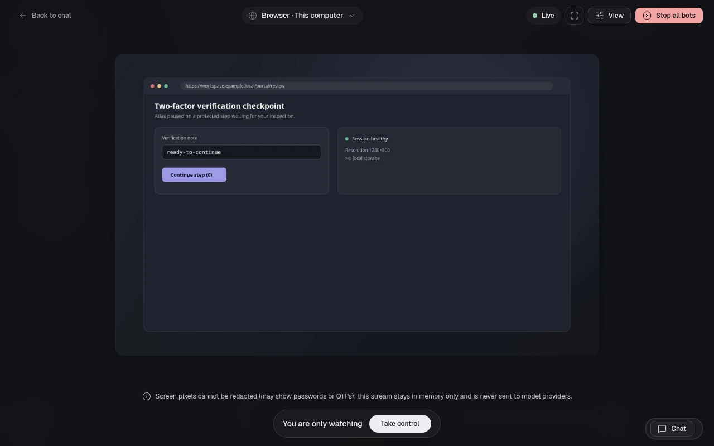

# Computer use on your own PC

Bots can work in apps on your Windows PC when the chat uses **This computer** and
the owner switch *Let my bots use this computer* is on. If it is off, the chat shows
a **Turn on computer use** card with one button.

## What a bot can do

| Tool | Purpose |
| --- | --- |
| `desktop_list_apps` | List visible windows (id, title, process). |
| `desktop_launch` | Start a program, document or URI. Packaged apps (for example WhatsApp) use `appx:<AppUserModelID>`. |
| `desktop_focus` | Bring an open window to the front and read it. |
| `desktop_window` | Minimise, maximise, restore, move, resize or close a window, by `window_id` or by part of its title. |
| `desktop_get_state` | Read a window's accessibility (UI Automation) tree: names, roles, screen bounds. Optional window-scoped screenshot. |
| `desktop_wait` | Wait until a window appears or goes away, an element appears, becomes enabled or goes away, or text becomes visible or disappears (up to 30 s). |
| `desktop_click`, `desktop_scroll`, `desktop_drag` | Act by element index (with `gen`) or, when the tree lacks the target, by screen x/y inside the observed window. |
| `desktop_element` | Invoke, toggle, expand, collapse or select an element, or scroll it into view, through the accessibility API. |
| `desktop_set_value` | Replace the value of a text field or combo box. |
| `desktop_type`, `desktop_key` | Type text; press a shortcut chord, or a sequence of chords. |
| `desktop_clipboard_read`, `desktop_clipboard_write` | Read or replace the text on the clipboard. |

The model is told to read the accessibility tree first and to take a screenshot only
when the tree does not expose the target.

### Window management

`desktop_window` takes `action` (`minimize`, `maximize`, `restore`, `move`, `resize`, `close`) and the window as
`window_id` (from `desktop_list_apps`) or a part of its `title`. A title that fits more than one window is refused with
the list of matches, so an operation never lands on a guess. `move` takes `x` and `y` (the top-left corner on the
screen), `resize` takes `width` and `height` in pixels. The result says where the window is now and which windows
appeared or went away, so a "save changes?" dialog that a `close` opened is reported at once.

### Accessibility actions

`desktop_element` acts through the accessibility API, so it does not move your pointer or type, and it works on a
window that is behind others:

| `action` | What it does | Windows (UI Automation) | Linux (AT-SPI) |
| --- | --- | --- | --- |
| `invoke` | Press a button, follow a link. | Invoke pattern | The element's default action |
| `toggle` (`on`: true or false) | Flip a check box, or set it; nothing happens when it is already in that state. | Toggle pattern | The element's toggle action and its *checked* state |
| `expand`, `collapse` | Open or close a tree item, combo box or menu. | ExpandCollapse pattern | An expand action and the *expanded* state |
| `select` | Select a list, tab, tree or radio item. | SelectionItem pattern | A `select` action, else the parent's Selection interface |
| `scroll_into_view` | Bring an element that is out of view into view. | ScrollItem pattern | Component `scroll_to` |

When the element does not support the action the call fails and says so; use `desktop_click` then. After each action
the result reads the state back (`verified: true`) where the platform allows it.

### Keyboard

Typed text is sent as Unicode, so it does not depend on the keyboard layout: accented letters, Turkish letters and
symbols work on any layout. `desktop_type` can replace the field's content first (`clear`) and press Enter afterwards
(`submit`). `desktop_key` presses a chord (`"ctrl+s"` or `["ctrl", "s"]`), or a `sequence` of chords
(`["ctrl+a", "Delete"]`), optionally `repeat`ed up to 20 times (at most 50 presses per call). Keys are named by what
they are: on Windows a punctuation key in a shortcut (`ctrl+/`) is the key your current layout gives that character.

### Clipboard

`desktop_clipboard_read` returns the text on the clipboard inside a data fence: it comes from whoever copied it, so it
is data and never instructions, exactly like page text. A run that reads it counts as having read untrusted, private
content. On Windows, content that a password manager marked as private is not returned. `desktop_clipboard_write`
replaces the text for a later paste (`desktop_key` with `ctrl+v`); it never pastes by itself. Cards show the size of
the text, and the text itself is on the card's details.

### Waiting instead of sleeping

`desktop_wait` takes `until`: `window_appears`, `window_gone`, `element_appears`, `element_enabled`, `element_gone`,
`text_visible` or `text_gone`, with `title` or `window_id`, `query` (part of an element's name or role) or `text`, and
`timeout_ms` (default 3 s, at most 30 s). It polls about every 200 ms and fails with a timeout when the condition never
holds. The text conditions read the window's elements, not pixels. When it succeeds on a window's contents it returns
that window's fresh state, ready to act on.

### Results that need fewer screenshots

Every action (`desktop_click`, `desktop_type`, `desktop_key`, `desktop_scroll`, `desktop_drag`, `desktop_set_value`,
`desktop_element`) returns the new state compactly: the windows that appeared or went away, the elements that changed
(old and new value or state), and the interactive elements with fresh indexes. Add `view: "full"` to get the whole tree
instead. A model can usually tell whether the action worked from this alone, without a screenshot.

## Safety

- Every focus, click, type, key, scroll, element action, window operation and clipboard write goes through the permission engine: it asks by default, and an approval can be limited to the current task. The same money, never-list and per-app rules apply as for any other action.
- **Closing a window always asks you**, whatever your permission level, because it can throw away unsaved work.
- A window of a program that must not be managed is refused: an elevated program, a system shell or sign-in surface, and a password manager.
- A run that read clipboard text has read untrusted content: a later action that could send data out asks first.
- Approved input is re-checked against the live window before it is sent; if a different window took focus the action is refused.
- Password fields are never typed into.
- Nothing runs while you are using the PC yourself, or while Stop / pause is active. The *Praxi is controlling your PC* indicator and the Stop hotkey stay in force.

## Not verified

- Behaviour with a real WhatsApp (packaged app) install was not tested on a live machine.
- A Notepad/Calculator integration test against the real desktop was not added; coverage is a fake backend plus unit tests.
- Linux/macOS peers: focus and wait fall back to "unsupported".
- Window management, clipboard and accessibility actions on **another computer** (a paired PC or server) are not available yet: they answer "unavailable". Only the local computer supports them.
- macOS has no desktop backend yet, so none of the above works there.
- The Windows (UI Automation, Win32) and Linux (AT-SPI, X11) code paths of the new tools were compiled for their targets and unit-tested for their pure logic; they were not run against real applications in this change.
