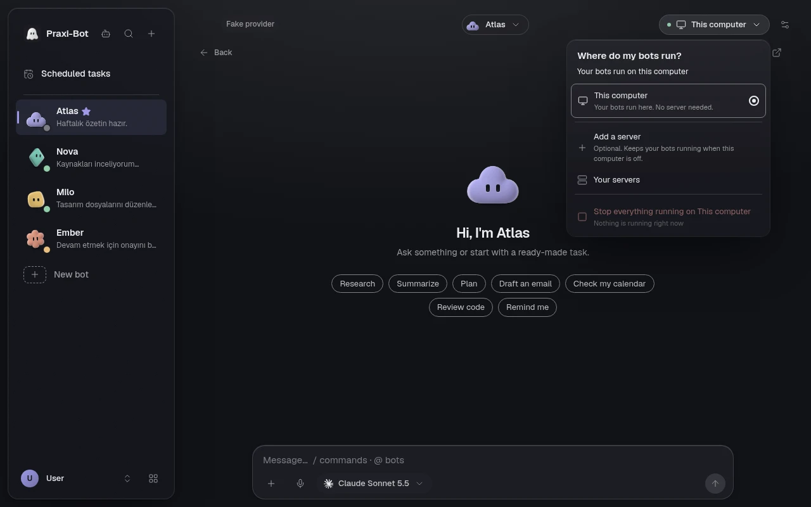

# Run it on this computer or on a server

**Short answer: run it on this computer. You do not need a server.**

## On this computer (the default)

Your bots run on the computer where you installed Praxi. They work while Praxi is open and your computer is awake.

- Easy: nothing more to set up.
- Private: your chats and files stay here.
- Limit: when your computer is off or asleep, your bots do not work. Scheduled jobs wait for you (see [Automate things](automate.md)).

In the app this computer is called **This computer**. You can see it in the computer menu at the top.

## On a server (optional)

A **server** is another computer that stays on day and night. Most people rent one online. Some use an old PC at home.

Choose a server only if:

- you want jobs to run at night while your own computer is off, or
- you want your bots to answer you from your phone at any hour.

Things to know first:

- A server can cost money. Some providers have a free plan.
- You need a few simple details: the server's address, a user name and a key file.
- A bot on a server works on the server's files, not on your own files.
- Your keys and chats for that bot live on the server. Treat it like a second computer you must keep safe.

## How to add a server

1. Open the computer menu at the top.
2. Choose **Add server…** (also called **Add a server**).
3. Follow the three short steps. Praxi checks the server and tells you what to fix.

The full walk-through, including a free option, is in [Adding a server](servers.md). Commands for a Linux server are in [Linux always-on host](linux-host.md).

## Go back or remove a server

- Pick **This computer** in the computer menu to work locally again.
- Open **Your servers** in the computer menu and press **Remove** to forget a server. The server itself and its bots keep running. Only this computer forgets it.

## If a server does not answer

The message "{name} did not answer" means the server is off or has no network. Turn it on and try again. More steps: [Fix common problems](fix-common-problems.md).
