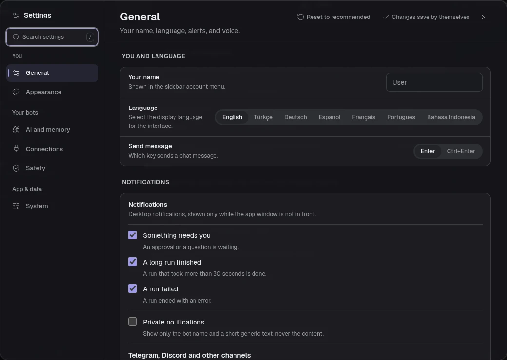

# Settings

Open **Settings** from the profile menu (your name at the bottom of the left
rail), with `Ctrl/Cmd+,`, or by typing `/settings` in the composer. Changes save
by themselves: the pill at the top right says **Saved** after each change.

On the **Safety** page you will see the left page list, the **More options**
switch (expert cards), **Reset to recommended**, the three safety levels, and
**What is this?** (`?`) popovers on several cards.

## The pages

Eight pages sit in three groups in the left list:

| Group | Page | What it is for |
| --- | --- | --- |
| **You** | **General** | Your name, language, notifications, voice, dictation, start with the computer, import from other assistants. |
| **You** | **Appearance** | Theme, accent, backdrop, wallpaper, readability. |
| **Your bots** | **AI and memory** | Models and API keys, what bots remember, documents and knowledge folders. |
| **Your bots** | **Connections** | Which computer bots run on, mail, calendar, web search (not Composio apps — use **Apps**). |
| **Your bots** | **Safety** | Safety level, trusted folders, allowed grants, activity log. |
| **Your bots** | **Vault** | Logins and secrets bots may use (whole page; opens from the menu or `/vault`). |
| **App** | **System** | Usage, spending limits, storage, diagnostics (`bot doctor`), logs. |
| **App** | **Updates** | Installed versions, update channel, release notes. |

Quick tiles at the top of the profile menu jump to **Appearance**, **AI**, and
**Usage** (the **System** page).

## Search

Type in the search box at the top left. Every setting is searched by its title,
its explanation and common alternative words (accents and capital letters do not
matter, so "gonder" finds "Gönder"). Matches are highlighted, and each result
shows the page it lives on.

## More options

By default each page shows what most people need. Rare cards sit behind **More
options** at the bottom (shown as **Advanced settings** when open). The
disclosure starts closed every time you open Settings; it opens by itself when a
search result or a deep link points at a hidden card. Searching always finds
advanced settings too.

Several cards have a **`?` icon**: hover or click for a short plain-language
explanation and a link to the matching guide page.

## Safety levels

Bots follow one of three levels unless you gave a bot its own rules:

| Level | Does on its own | Asks you first |
| --- | --- | --- |
| **Careful** | Read files, look things up, draft text. | Edit or save a file, send a message or email, open a web page, run a command. |
| **Balanced** (recommended) | Read, browse, edit files in the work area. | Delete things, send messages or email, spend money, use your own computer. |
| **Hands-off** | Almost everything, including deleting and sending. In a run you start yourself it also browses, clicks and types on the web without asking, even after reading a page. | Spending money, dangerous commands, typing a stored secret, sending mail, and, after reading an untrusted page, running a program. If the run also holds your private data (files, mail, memory), a new site or a form that contains a piece of it. |

These are the daemon presets `read-and-draft`, `approve-destructive` and `full`.
The older "Read-only" preset and per-category rules stay available under **More
options** on the same page.

## Reset to recommended

**General**, **Appearance**, and **Safety** have **Reset to recommended**. It
asks first, and it only changes that page: your bots, chats and keys are never
touched. On **Safety** it puts the level back to Balanced and keeps your "Always
allow" rules.

## Small screens

Down to 640 px wide the page list becomes a row you can scroll sideways above the
settings.

See the [glossary](glossary.md) for words such as *approval*, *host* and *preset*.