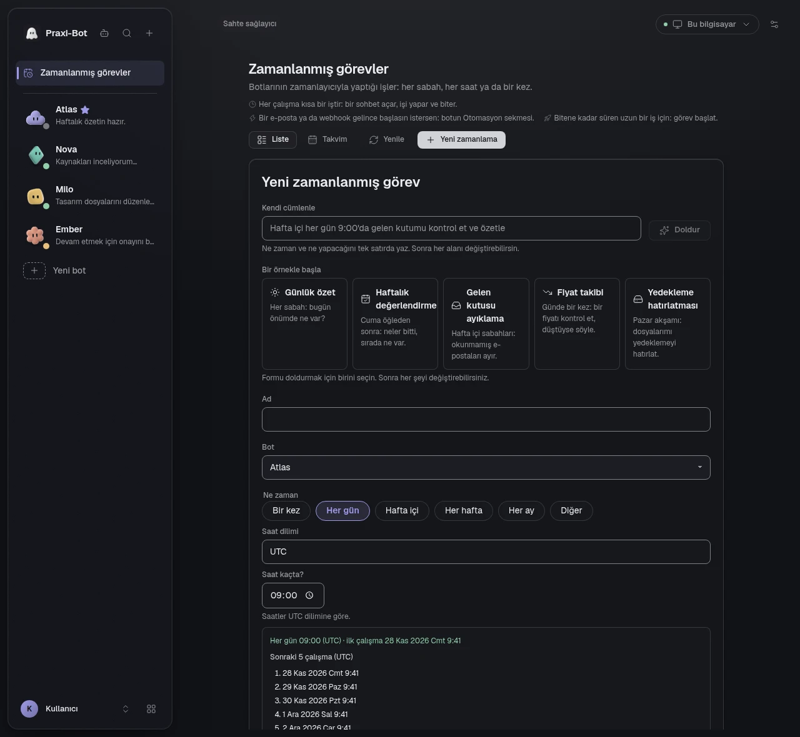
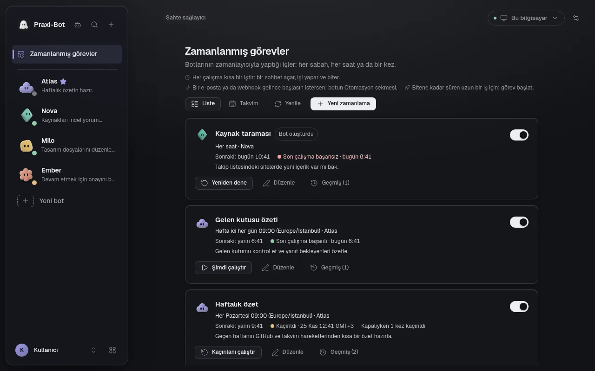
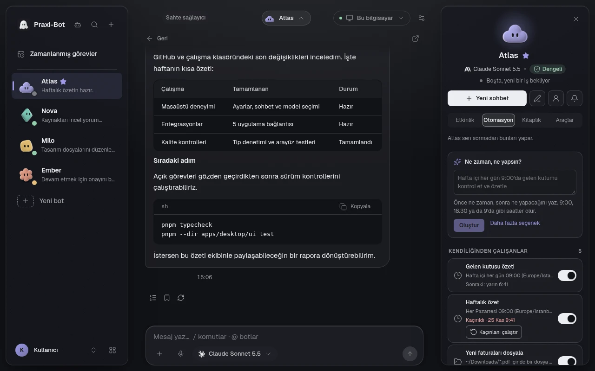

# İşleri otomatikleştir

**Zamanlanmış iş**, bir botun senin seçtiğin zamanlarda kendiliğinden bir şey yapmasını sağlar. Örneğin: "her sabah bugün önümde ne var söyle". Bir kez kurarsın. Sonra kendi kendine çalışır.

## İlk işini oluştur

1. Sol çubukta **Zamanlanmış görevler**'e tıkla.
2. **Yeni zamanlama**'ya bas. **Yeni zamanlanmış görev** penceresi açılır.
3. **Bir örnekle başla** altında bir örneğe tıkla. Form dolar. Sonra her şeyi değiştirebilirsin.
4. **Ne sıklıkla?** altında **Bir kez**, **Her gün**, **Hafta içi**, **Her hafta**, **Her ay** ya da **Diğer**'i seç.
5. **Saat kaçta?** altında saati seç. Praxi kullandığı saat dilimini gösterir. Ayrıca **Sonraki 5 çalışma**'yı gösterir. Bunun istediğin şey olduğunu kontrol et.
6. **İstem**'i kontrol et. Botun her seferinde yapması istenen şey budur. Kendi sözlerinle yaz.
7. **Çalışınca bana haber ver** altında **Her seferinde**, **Sadece bir sorun olursa** ya da **Hiçbir zaman**'ı seç.
8. **Oluştur**'a bas.

## Kopyalayabileceğin üç örnek

### 1. Günlük özet

- **Ne sıklıkla?** Her gün, 08:00.
- **İstem:** "Okunmamış e-postalarımı ve bugünkü takvimimi beş kısa maddede özetle. En acil olanı en başa koy."
- Gerekenler: e-postan ve takvimin bağlı olmalı. Bkz. [Uygulamalarını bağla](connect-your-apps.md).
- Güvenli, çünkü bot yalnızca okur ve bir özet yazar.

### 2. Haftalık değerlendirme

- **Ne sıklıkla?** Her hafta, Cuma 17:00.
- **İstem:** "Bu haftaki sohbetlerime ve notlarıma bak. Nelerin bittiğini, nelerin açık kaldığını ve Pazartesi başlanacak üç şeyi listele."
- Gerekenler: ek bir şey yok.

### 3. Fiyat takibi

- **Ne sıklıkla?** Her gün, 12:00.
- **İstem:** "Aşağıda belirttiğim ürün sayfasını aç, güncel fiyatı oku ve dünden düşükse söyle. Ürün sayfası: (bağlantıyı buraya yapıştır)"
- Gerekenler: parantez içindeki metni kendi bağlantınla değiştir. Bot o sayfayı açar; bu yüzden **Dikkatli** modda önce sorabilir.

Aynı listede **Gelen kutusu ayıklama** ve **Yedekleme hatırlatması** da var.

## Saati sözlerle söyle

**Diğer**'i seç ve saati kendi sözlerinle yaz. Örneğin "every weekday at 9" ya da "her gün 09:00". İngilizce ve Türkçe çalışır. Sözlerini bir yapay zekâ modeli değil, sabit bir kural takımı okur. **Oluştur**'a basmadan önce neyin anlaşıldığını her zaman görürsün.

## Bilgisayar kapalıysa

İşler yalnızca Praxi uyanık bir bilgisayarda açıkken çalışır. **Planlanan zamanda bilgisayar kapalıysa** altında şunu seçersin:

- **Atla ve bir sonraki zamanı bekle** (varsayılan).
- **Bilgisayar açılınca bir kez çalıştır**.
- **Yetiş: kaçan her zamanı çalıştır (en çok 10)**.

İşlerin geceleri çalışmasını istiyorsan sunucu kullan. Bkz. [Bu bilgisayarda mı, sunucuda mı çalışsın](local-or-server.md).

## Şimdi çalıştır, düzenle, duraklat, sil

Her işte **Şimdi çalıştır**'a, **Düzenle**'ye ya da **Sil**'e basabilirsin. Başarısız olan ya da kaçırılan işte **Yeniden dene** vardır. Silmeden önce onay istenir.

## Güvenlik

- Bir iş, botunun izinlerine sahiptir; asla fazlasına değil.
- Bir iş onayını gerektiriyorsa **Senden bekleyenler**'de bekler. Kendi başına ilerlemez. Kimse yanıt vermezse yanıt hayır olur.
- İşin okuduğu web sayfaları ve e-postalar bilgidir, emir değildir.
- Koyduğun harcama limitleri işler için de geçerlidir.
- **Tam** seviyedeki bir botta, **senin** yazdığın bir iş ya da kural sormadan çalışır (para harcamak yine sorar). Bir botun yaptığı ya da yazarı bilinmeyen bir iş, üzerindeki **Bu benim** düğmesine basana kadar sormaya devam eder. Bkz. [Tam seviye: kendi zamanlamaların ve tetikleyicilerin](chatting-and-approvals.md#tam-seviye-kendi-zamanlamaların-ve-tetikleyicilerin).

Daha fazlası: [Zamanlanmış işler, sade sözlerle](schedules.md) ve [teknik başvuru](scheduled-tasks.md).

## Botu dışarıdan başlat

Bir **webhook**, başka bir şey bir adresi çağırınca bu botu başlatır: GitHub, bir form ya da evdeki bir anahtar.

1. Bot panelini aç ve **Otomasyon**'u seç.
2. Webhook'a bir ad ver. İstersen botun veriyle ne yapacağını yaz. **Webhook oluştur**'a bas.
3. Gizli anahtarı hemen kopyala. Praxi onu yalnızca bu kez gösterir.
4. Praxi yalnızca bu bilgisayarı dinler. Kendi seçtiğin bir tüneli (Cloudflare Tunnel ya da ssh) `127.0.0.1` adresine yönelt. Yönlendiricide yeni bir kapı açma.

Her çağrı `X-Webhook-Timestamp` başlığında zamanı ve `X-Signature-256: sha256=` ile o zamanın, bir noktanın ve ham metnin HMAC imzasını gönderir. Aynı imzalı çağrı bir kez geçerlidir ve yalnızca 5 dakika içinde. Metin en fazla 64 KB olabilir. Dakikada 30 çağrıdan fazlası reddedilir. Metin veridir, emir değildir. Bot yine harekete geçmeden önce sorar; soru bir bildirim olarak görünür.

**Test gönder**, uygulamadan bir çalışma başlatır. Dışarıdaki hız sınırını kullanmaz.

Daha fazlası: [Gelen webhook'lar](incoming-webhooks.md).
