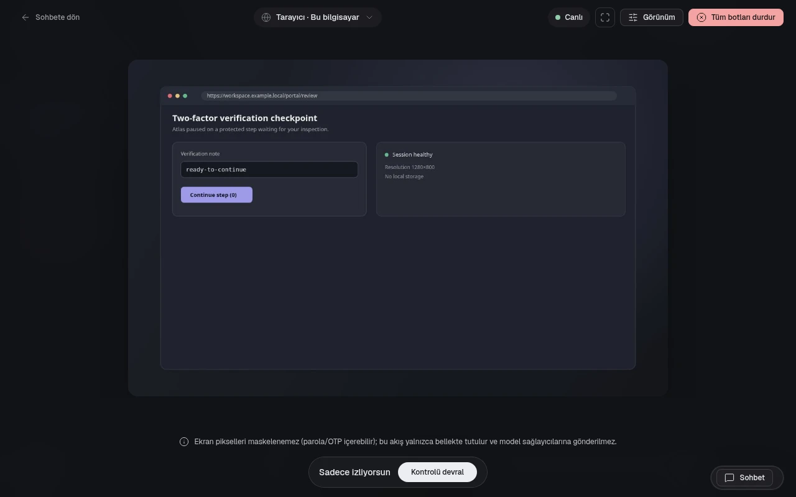

# Kendi bilgisayarında bilgisayar kullanımı

Sohbet **Bu bilgisayar**'ı kullanıyorsa ve sahip anahtarı *Botlarım bu bilgisayarı kullanabilsin* açıksa,
botlar Windows bilgisayarındaki uygulamalarda çalışabilir. Kapalıysa sohbette tek düğmeli bir
**Bilgisayar kullanımını aç** kartı görünür.

## Bir bot neler yapabilir

| Araç | Amacı |
| --- | --- |
| `desktop_list_apps` | Görünen pencereleri listeler (kimlik, başlık, işlem). |
| `desktop_launch` | Bir program, belge ya da URI başlatır. Paketlenmiş uygulamalar (örneğin WhatsApp) `appx:<AppUserModelID>` kullanır. |
| `desktop_focus` | Açık bir pencereyi öne getirir ve okur. |
| `desktop_window` | Bir pencereyi `window_id` ile ya da başlığının bir parçasıyla küçültür, büyütür, eski haline getirir, taşır, boyutlandırır ya da kapatır. |
| `desktop_get_state` | Bir pencerenin erişilebilirlik (UI Automation) ağacını okur: adlar, roller, ekran sınırları. İsteğe bağlı olarak pencereye özel ekran görüntüsü. |
| `desktop_wait` | Bir pencere açılana ya da kapanana, bir öğe belirene, etkinleşene ya da kaybolana veya bir metin görünene ya da kaybolana kadar bekler (en çok 30 sn). |
| `desktop_click`, `desktop_scroll`, `desktop_drag` | Öğe sırasına göre (`gen` ile) ya da ağaçta hedef yoksa gözlenen pencerenin içinde ekran x/y konumuna göre işlem yapar. |
| `desktop_element` | Bir öğeyi erişilebilirlik API'siyle çalıştırır, açık/kapalı yapar, genişletir, daraltır, seçer ya da görünür alana kaydırır. |
| `desktop_set_value` | Bir metin alanının ya da açılır kutunun değerini değiştirir. |
| `desktop_type`, `desktop_key` | Metin yazar; bir kısayol tuşu bileşimine ya da bir bileşim dizisine basar. |
| `desktop_clipboard_read`, `desktop_clipboard_write` | Panodaki metni okur ya da değiştirir. |

Modele önce erişilebilirlik ağacını okuması, ekran görüntüsünü ise yalnızca ağaç hedefi göstermediğinde alması söylenir.

### Pencere yönetimi

`desktop_window`, `action` (`minimize`, `maximize`, `restore`, `move`, `resize`, `close`) ve pencereyi `window_id`
(`desktop_list_apps`'ten) ya da `title`'ın bir parçası olarak alır. Birden fazla pencereye uyan bir başlık, eşleşenlerin
listesiyle reddedilir; böylece işlem hiçbir zaman tahmin edilen bir pencereye gitmez. `move` için `x` ve `y` (sol üst
köşenin ekrandaki konumu), `resize` için piksel cinsinden `width` ve `height` verilir. Sonuç, pencerenin şimdi nerede
olduğunu ve hangi pencerelerin açıldığını ya da kapandığını söyler; yani `close` sonrası çıkan "değişiklikler
kaydedilsin mi?" penceresi hemen bildirilir.

### Erişilebilirlik eylemleri

`desktop_element` erişilebilirlik API'siyle çalışır; bu yüzden fareni oynatmaz, yazı yazmaz ve başka pencerelerin
arkasında kalan bir pencerede de çalışır:

| `action` | Ne yapar | Windows (UI Automation) | Linux (AT-SPI) |
| --- | --- | --- | --- |
| `invoke` | Düğmeye basar, bağlantıyı açar. | Invoke deseni | Öğenin varsayılan eylemi |
| `toggle` (`on`: true ya da false) | Onay kutusunu çevirir ya da istenen duruma getirir; zaten o durumdaysa bir şey yapmaz. | Toggle deseni | Öğenin değiştirme eylemi ve *işaretli* durumu |
| `expand`, `collapse` | Bir ağaç öğesini, açılır kutuyu ya da menüyü açar veya kapatır. | ExpandCollapse deseni | Bir genişletme eylemi ve *açık* durumu |
| `select` | Bir liste, sekme, ağaç ya da seçenek öğesini seçer. | SelectionItem deseni | `select` eylemi, yoksa üst öğenin Selection arayüzü |
| `scroll_into_view` | Görünür alanın dışındaki bir öğeyi görünür alana getirir. | ScrollItem deseni | Component `scroll_to` |

Öğe eylemi desteklemiyorsa çağrı başarısız olur ve bunu söyler; o zaman `desktop_click` kullanılır. Platform izin
verdiği yerde, her eylemden sonra sonuç durumu geri okur (`verified: true`).

### Klavye

Yazılan metin Unicode olarak gönderilir, yani klavye düzenine bağlı değildir: aksanlı harfler, Türkçe harfler ve
semboller her düzende çalışır. `desktop_type` önce alanın içeriğini değiştirebilir (`clear`) ve sonunda Enter'a
basabilir (`submit`). `desktop_key` bir tuş bileşimine (`"ctrl+s"` ya da `["ctrl", "s"]`) ya da bir bileşim dizisine
(`sequence`, örneğin `["ctrl+a", "Delete"]`) basar; istenirse en çok 20 kez `repeat` edilir (çağrı başına en çok 50
basış). Tuşlar ne olduklarıyla adlandırılır: Windows'ta bir kısayoldaki noktalama tuşu (`ctrl+/`), o anki düzenin o
karaktere verdiği tuştur.

### Pano

`desktop_clipboard_read`, panodaki metni bir veri çitinin içinde döndürür: metni kopyalayan kişi yazdığı için bu bir
veridir, asla talimat değildir; tıpkı sayfa metni gibi. Bunu okuyan bir çalışma, güvenilmeyen ve özel içerik okumuş
sayılır. Windows'ta bir parola yöneticisinin özel işaretlediği içerik döndürülmez. `desktop_clipboard_write`, daha
sonra yapıştırmak için metni değiştirir (`desktop_key` ile `ctrl+v`); kendiliğinden yapıştırmaz. Kartlar metnin
boyutunu gösterir; metnin kendisi kartın ayrıntılarındadır.

### Uyumak yerine beklemek

`desktop_wait` bir `until` alır: `window_appears`, `window_gone`, `element_appears`, `element_enabled`,
`element_gone`, `text_visible` ya da `text_gone`; yanında `title` ya da `window_id`, `query` (bir öğenin adının ya da
rolünün parçası) veya `text` ve `timeout_ms` (varsayılan 3 sn, en çok 30 sn) verilir. Yaklaşık her 200 ms'de bir
yoklar; koşul hiç gerçekleşmezse zaman aşımı hatasıyla biter. Metin koşulları pikselleri değil, pencerenin öğelerini
okur. Bir pencerenin içeriği üzerinde başarılı olursa, o pencerenin taze durumunu, hemen işlem yapılabilecek şekilde
döndürür.

### Daha az ekran görüntüsü gerektiren sonuçlar

Her eylem (`desktop_click`, `desktop_type`, `desktop_key`, `desktop_scroll`, `desktop_drag`, `desktop_set_value`,
`desktop_element`) yeni durumu kısa biçimde döndürür: açılan ya da kapanan pencereler, değişen öğeler (eski ve yeni
değer ya da durum) ve taze sıra numaralarıyla etkileşimli öğeler. Ağacın tamamı için `view: "full"` eklenir. Bir model,
eylemin işe yarayıp yaramadığını çoğunlukla yalnızca bundan anlayabilir; ekran görüntüsü gerekmez.

## Güvenlik

- Her odaklanma, tıklama, yazma, tuş, kaydırma, öğe eylemi, pencere işlemi ve pano yazma izin motorundan geçer: varsayılan olarak sorar ve bir onay yalnızca o anki görevle sınırlanabilir. Diğer tüm eylemlerdeki para, yasaklı komut ve uygulama başına kurallar burada da geçerlidir.
- **Bir pencereyi kapatmak her zaman sana sorar**, izin düzeyin ne olursa olsun; çünkü kaydedilmemiş işi kaybettirebilir.
- Yönetilmemesi gereken bir programın penceresi reddedilir: yükseltilmiş (yönetici) bir program, bir sistem kabuğu ya da oturum açma yüzeyi ve bir parola yöneticisi.
- Pano metnini okuyan bir çalışma, güvenilmeyen içerik okumuş sayılır: sonrasında veri dışarı gönderebilecek bir eylem önce sorar.
- Onaylanan girdi, gönderilmeden önce canlı pencereye karşı yeniden denetlenir; başka bir pencere odağı almışsa işlem reddedilir.
- Parola alanlarına asla yazılmaz.
- Sen bilgisayarı kendin kullanırken ya da Durdur / duraklat etkinken hiçbir şey çalışmaz. *Praxi bilgisayarını yönetiyor* göstergesi ve Durdur kısayolu her zaman geçerlidir.

## Doğrulanmayanlar

- Gerçek bir WhatsApp (paketlenmiş uygulama) kurulumuyla davranış, canlı bir makinede denenmedi.
- Gerçek masaüstüne karşı bir Not Defteri/Hesap Makinesi entegrasyon testi eklenmedi; kapsam, sahte bir arka uç ve birim testlerinden oluşuyor.
- Linux/macOS eşleri: odaklanma ve bekleme "desteklenmiyor" yanıtına döner.
- **Başka bir bilgisayarda** (eşleşmiş bir PC ya da sunucu) pencere yönetimi, pano ve erişilebilirlik eylemleri henüz yok: "kullanılamıyor" yanıtı verir. Yalnızca yerel bilgisayar destekler.
- macOS'un henüz masaüstü arka ucu yok; bu yüzden yukarıdakilerin hiçbiri orada çalışmaz.
- Yeni araçların Windows (UI Automation, Win32) ve Linux (AT-SPI, X11) kod yolları kendi hedefleri için derlendi ve saf mantıkları birim testlerle sınandı; bu değişiklikte gerçek uygulamalara karşı çalıştırılmadı.
