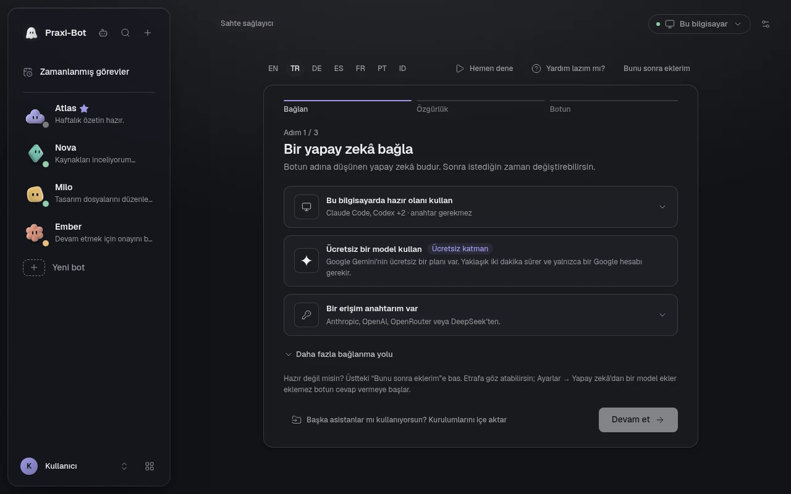
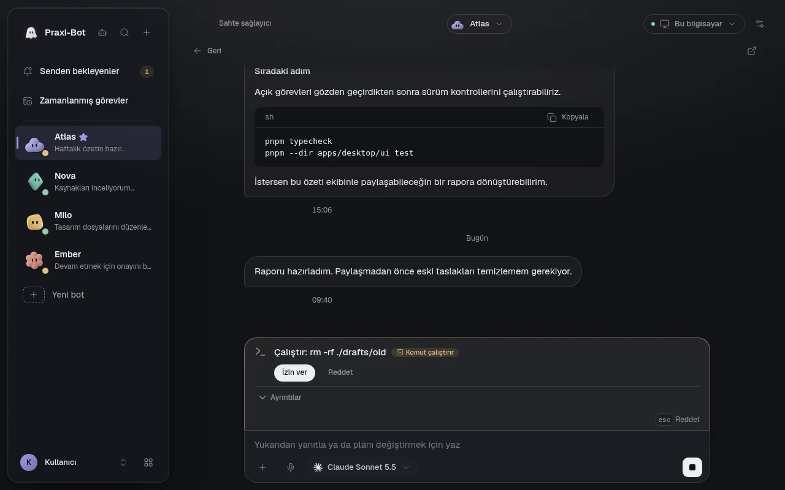

# 5 dakikada başlangıç

Bu sayfa seni hiçbir şeyden ilk sohbetine kadar götürür. Kod yazmayı bilmen gerekmez.

> **Resimler:** "Resim:" ile başlayan satırlar, sonradan eklenecek bir ekran görüntüsünü anlatır. Yalnızca ne görmen gerektiğini söyler.

## Bot nedir?

**Bot**, bilgisayarında senin için çalışan bir yardımcıdır. Ona bir arkadaşına yazar gibi yazarsın. Dosya okuyabilir, internette bir şey arayabilir, küçük işler yapabilir. Bir şeyi değiştirmeden önce sana sorar.

İlk botunun adı **Praxi**. Sonra daha fazla bot oluşturabilirsin. Her botun kendi kuralları olabilir.

## 1. Adım: Kur

1. Windows kurulum dosyasını (`.exe` ile biten dosya) projenin sürümler sayfasından indir.
2. Aç. Yönetici hakkı gerekmez.
3. Windows mavi bir uyarı ("SmartScreen") gösterebilir. Yeni uygulamalarda bu normaldir. **Daha fazla bilgi**'ye, sonra **Yine de çalıştır**'a bas.
4. Kurulum bitince Praxi kendiliğinden açılır.

Ayrıntılar: [Windows'a kurulum](install-windows.md).

> **Resim:** **Daha fazla bilgi** ve **Yine de çalıştır** düğmeleriyle Windows uyarısı.

## 2. Adım: Ücretsiz bir anahtar al

Botunun bir "beyne" ihtiyacı var. Bu, bir çevrimiçi servisten gelen yapay zekâ modelidir. Servis sana bir **anahtar** verir. Anahtar, uzun bir harf ve rakam satırıdır. Botun için bir parola gibi çalışır.

Google Gemini'nin ücretsiz bir planı var. Yalnızca bir Google hesabı yeter.

1. **Bir beyin seç** ekranında **Ücretsiz bir model kullan**'ı bul.
2. **Anahtarımı al**'a bas. Tarayıcında bir Google sayfası açılır.
3. Google ile giriş yap ve **Create API key**'e bas. Anahtarı kopyala.
4. Praxi'ye dön ve anahtarı kutuya yapıştır. Praxi hemen kontrol eder.

Anahtarın bilgisayarının kendi parola deposuna kaydedilir. Praxi onu bir daha göstermez.

Hazır değil misin? **Bunu sonra eklerim**'e bas. Etrafa göz atabilirsin. Anahtar ekler eklemez botun yanıt vermeye başlar.

Modeller ve anahtarlar hakkında daha fazlası: [Sağlayıcılar ve modeller](providers-and-models.md).

## 3. Adım: Ne kadar serbest olacağını seç

**Ne kadar serbest olsun?** ekranında üç seviyeden birini seçersin:

- **Sorar**: bot bir şeyi değiştirmeden önce sana sorar.
- **Dengeli** (önerilen): bot etrafa kendi bakar; bir şeyi değiştirmeden ya da göndermeden önce sorar.
- **Serbest**: bot işini kendi halleder. Ödemelerde yine durur.

Emin değilsen **Dengeli**'yi bırak. Sonra değiştirebilirsin. Bkz. [Botunu güvende tut](keep-your-bot-safe.md).

## 4. Adım: Botunla tanış

**Botunla tanış** ekranında botuna bir ad ve bir görünüm ver. Sonra **Başla**'ya bas. **Önce şunu dene** altında tıklayabileceğin hazır sorular görürsün.

> **Resim:** **Önce şunu dene** önerileriyle **Botunla tanış** ekranı.

## İlk sohbetin

1. **Önce şunu dene** sorularından birine tıkla ya da mesaj kutusuna kendi sorunu yaz.
2. **Gönder**'e bas.
3. Bot senin onayını gerektiren bir şey yapmak isterse **Onay gerekiyor** başlıklı bir kart çıkar. Oku. **Bir kez izin ver**'e ya da **Reddet**'e bas.
4. Botu istediğin an durdurmak için **Durdur**'a bas.

İyi ilk sorular:

- "Bu klasörü özetle"
- "Bir komşuma kısa ve samimi bir mesaj yazmama yardım et"
- "Bugünün en önemli yapay zekâ haberlerini bul"

## Sonra nereye?

- [Botunu güvende tut](keep-your-bot-safe.md): bot neler yapabilir, bilgisayarından ne çıkar.
- [İşleri otomatikleştir](automate.md): botun her gün bir iş yapsın.
- [Uygulamalarını bağla](connect-your-apps.md): Gmail, Takvim ve daha fazlası.
- [Bu bilgisayarda mı, sunucuda mı çalışsın](local-or-server.md): sunucuya ihtiyacın yok.
- [Sık görülen sorunları çöz](fix-common-problems.md): bir şey çalışmadığında.
- [Hızlı yanıtlar](quick-faq.md): sık sorulan sorulara kısa yanıtlar.

İstediğin an hesap menüsünden **Yardım**'ı da açabilirsin.
