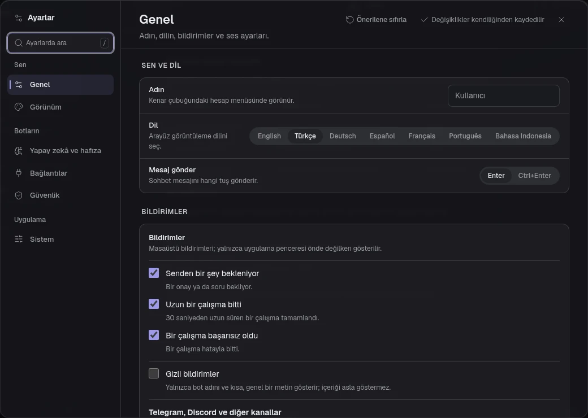

# Ayarlar

**Ayarlar**'ı hesap menüsünden aç. Her şey sade adlı on sayfada toplanmıştır.
Değişiklikler kendiliğinden kaydedilir: her değişiklikten sonra sağ üstteki etikette **Kaydedildi** yazar.

Güvenlik ve izinler sayfasında soldaki sayfa listesini, Basit / Gelişmiş anahtarını, "Önerilene sıfırla" düğmesini ve üç güvenlik düzeyini görürsün.

## Sayfalar

| Sayfa | Ne işe yarar |
| --- | --- |
| **Genel** | Adın, dilin, mesajı hangi tuşun göndereceği, bilgisayarla birlikte başlatma. |
| **Görünüm** | Tema, vurgu rengi, arka plan ve duvar kâğıdı (Bulut hareketi dahil). |
| **Bildirimler** | Uygulamanın seni ne zaman uyaracağı, sessiz saatler, sessize alınmış botlar. |
| **Ses** | Yanıtların sesli okunması, yazmak yerine konuşma. |
| **Botlar ve modeller** | Botlarının düşünürken kullandığı yapay zekâ: bu bilgisayarda bulunan hesaplar, erişim anahtarları, varsayılan model. |
| **Botların çalıştığı yer** | Botlarının çalıştığı bilgisayar. |
| **Uygulamalar ve bağlantılar** | Botların kullanabileceği e-posta ve web araması. |
| **Güvenlik ve izinler** | Botların kendi başlarına neler yapabileceği, güvenilen klasörler, güvenli kip. |
| **Veri ve yedek** | Botların neyi hatırladığı ve bildiği, ne kadar kullandığın. |
| **Gelişmiş** | Sağlık denetimi, onarım, sürüm. Çoğu kişinin buna hiç ihtiyacı olmaz. |

## Arama

Sol üstteki arama kutusuna yaz. Her ayar; başlığına, açıklamasına ve yaygın alternatif sözcüklerine göre aranır
(aksanlar ve büyük harfler önemli değildir, yani "gonder" yazınca "Gönder" bulunur). Eşleşmeler vurgulanır
ve her sonuç hangi sayfada olduğunu gösterir.

## Basit ve Gelişmiş

**Basit**, çoğu kişinin ihtiyaç duyduklarını gösterir. Uzman seçenekleri **Gelişmiş**'in arkasındadır; bir sayfanın
sonundaki kesik çizgili düğme kaç tanesinin gizli olduğunu söyler. Seçimin hatırlanır. Arama, gelişmiş ayarları da her zaman bulur.

## Güvenlik düzeyleri

Bir bota özel kurallar vermediysen botlar üç düzeyden birine uyar:

| Düzey | Kendi başına yapar | Önce sana sorar |
| --- | --- | --- |
| **Dikkatli** | Dosya okur, bir şeyleri araştırır, metin taslağı hazırlar. | Dosya düzenler ya da kaydeder, mesaj ya da e-posta gönderir, web sayfası açar, komut çalıştırır. |
| **Dengeli** (önerilen) | Okur, gezinir, çalışma alanındaki dosyaları düzenler. | Bir şeyleri siler, mesaj ya da e-posta gönderir, para harcar, senin bilgisayarını kullanır. |
| **Serbest** | Silme ve gönderme dahil hemen her şeyi. Kendi başlattığın bir çalışmada bir sayfa okuduktan sonra bile sormadan web'de gezer, tıklar ve yazar. | Para harcama, tehlikeli komutlar, kayıtlı bir sırrı yazmak, e-posta göndermek ve güvenilmeyen bir sayfa okunduktan sonra program çalıştırmak. Çalışma ayrıca özel verini (dosya, posta, hafıza) tutuyorsa, bunlardan bir parçayı içeren yeni bir site ya da form. |

Bunlar daemon'un `read-and-draft`, `approve-destructive` ve `full` hazır ayarlarıdır. Eski "Salt okunur" hazır ayarı
ile kategoriye göre kurallar, aynı sayfada **Gelişmiş** altında durmaya devam eder.

## Önerilene sıfırla

Kendi ayarları olan sayfalarda **Önerilene sıfırla** düğmesi bulunur. Önce sorar ve yalnızca o sayfayı değiştirir:
botlarına, sohbetlerine ve anahtarlarına asla dokunmaz. **Güvenlik ve izinler** sayfasında düzeyi Dengeli'ye geri alır
ve "Her zaman izin ver" kurallarını korur.

## Küçük ekranlar

640 px genişliğe kadar sayfa listesi, ayarların üstünde yana kaydırabileceğin bir satıra dönüşür.

*Onay*, *ana makine* ve *hazır ayar* gibi sözcükler için [sözlüğe](glossary.md) bak.
